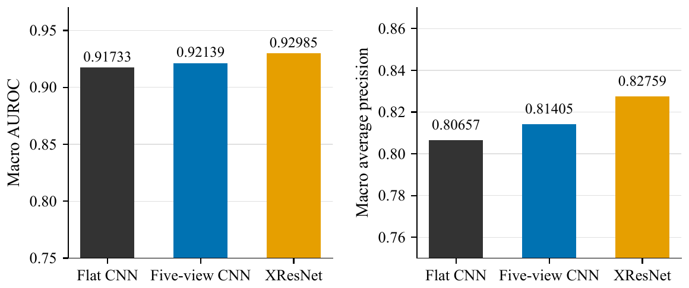
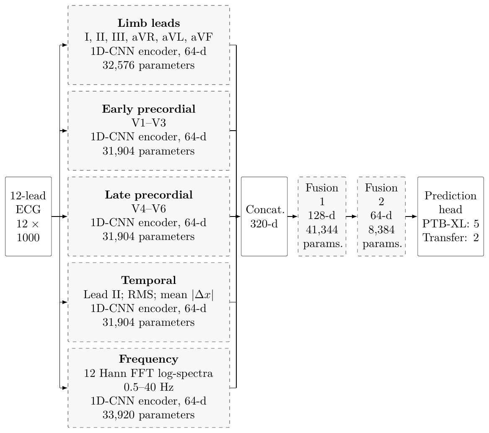

# Early Prediction of Cardiovascular Diseases using Deep Learning

**Authors:** Parth Mishra and Mohammed Abdul Muqsith Siddique  
**Supervisor:** Prof. Pradeep Kumar Das  
**Institution:** National Institute of Technology Warangal, 2026

This project uses a five-view CNN to predict cardiovascular conditions from routine 12-lead ECGs and studies how to adapt it to a new population or hospital with few labelled ECGs. On PTB-XL, it achieves macro AUROC **0.921** and AP **0.814** with **212K parameters**, about **8.8× fewer** than the project's XResNet reference. Its AUROC numerically matches the [published Inception1D result](https://doi.org/10.1109/JBHI.2020.3022989) of **0.921**.



*Macro AUROC and AP on the PTB-XL held-out test set (mean of two training seeds).*

The published Inception1D value is context, not a paired comparison; dataset releases and implementations differ.

The endpoints are ECG annotations and harmonised annotation proxies; this work does not predict future cardiovascular events or establish clinical utility.

## Architecture



The five-view CNN has **212,261 parameters** for the five-label PTB-XL task:

| View | Input |
|---|---|
| Limb leads | I, II, III, aVR, aVL and aVF |
| Early precordial | V1–V3 |
| Late precordial | V4–V6 |
| Temporal | Lead II, across-lead RMS and mean absolute first difference |
| Frequency | Twelve Hann-window log spectra, 0.5–40 Hz |

Each view produces a 64-dimensional CNN embedding. Concatenation gives 320 features, followed by fusion layers of width 128 and 64 and an independent sigmoid output for each label. Five-class prediction uses NORM, MI, STTC, CD and HYP; transfer uses CD and STTC annotation proxies. The five encoders and two fusion modules are separately selectable, with the prediction head trainable during adaptation. Derived views are transformations of the same ECG, not independent clinical measurements.

See [architecture details](docs/ECG_ARCHITECTURE.md) and the [model implementation](src/dmvmat_ecg/models/networks.py).

## Results

### Experiment 1 — PTB-XL diagnostic prediction

Macro metrics on the official held-out test set, averaged across the two training seeds:

| Model | Macro AUROC | Macro AP |
|---|---:|---:|
| Flat CNN | 0.917 | 0.807 |
| Five-view CNN | 0.921 | 0.814 |
| XResNet | 0.930 | 0.828 |

The five-view model improves on the capacity-matched flat CNN but does not outperform the larger XResNet reference. The latter uses a different crop-based prediction pipeline, so its comparison is not capacity-matched.

### Experiments 2–4 — Population and hospital transfer

Experiment 2 studies internal age-subgroup transfer. Experiment 3 measures zero-shot hospital shift. Experiment 4 compares adaptation methods on CPSC using **128 labelled target ECGs**:

| Method | Macro AP | Macro AUROC |
|---|---:|---:|
| Source-only | 0.541 | 0.782 |
| Head-only fine-tuning | 0.546 | 0.792 |
| Full fine-tuning | 0.651 | 0.844 |
| Random module selection | 0.608 | 0.828 |
| Proposed selective adaptation | 0.604 | 0.829 |
| Training from scratch | 0.580 | 0.744 |

With 128 labelled ECGs from a new hospital, full fine-tuning recovers +0.110 AP (0.541 → 0.651).

**Key finding:** proposed selective adaptation did not outperform full fine-tuning: ΔAP **−0.047**, with a conditional 95% confidence interval **[−0.053, −0.041]**. This is exploratory, record-level evidence for the specified CPSC annotation-proxy task. It does not establish external clinical validity or the value of evidence-guided selection over random selection.

The protocol and analyses were fixed before held-out testing. An initial target-label parsing error was corrected under a documented review without changing predictions. Dataset reuse, annotation differences, unavailable CPSC patient identities and first-ten-second truncation limit interpretation.

Research notes: [project summary](docs/PROJECT_RESULTS_SUMMARY.md), [PTB-XL comparison](docs/EXPERIMENT_RESULTS.md), [reference fidelity](docs/BASELINE_REPRODUCTION.md). Generated result files, fitted models, participant tables and the thesis report are excluded from the current source snapshot. Earlier research commits retain aggregate summaries and figures, not individual-record data.

## Datasets

Data are **not included**. Download them from the official sources and follow their respective licences, attribution requirements and access terms:

- [PTB-XL v1.0.3](https://physionet.org/content/ptb-xl/1.0.3/).
- [PhysioNet/Computing in Cardiology Challenge 2021 v1.0.3](https://physionet.org/content/challenge-2021/1.0.3/), including CPSC 2018, Georgia, and Chapman–Ningbo sources.

The Challenge collection also contains PTB-XL copies; the collection as a whole is not independent of PTB-XL. The cross-hospital experiments exclude those copies. An absent diagnosis code means not annotated, not a clinically verified negative. See the [dataset instructions](data/README.md).

## Quick start

Recorded environment: **Python 3.12.14**, **PyTorch 2.15.0**, macOS 26.6 on Apple Silicon. The research models used CPU float32; `uv.lock` records the resolved dependencies.

```bash
uv sync --frozen
uv run pytest -q
uv run ruff check src scripts tests
uv run ruff format --check src scripts tests

uv run python scripts/download_ptbxl.py
uv run python scripts/audit_dataset.py
uv run python scripts/device_probe.py
uv run python scripts/train_study.py --stage smoke
uv run python scripts/train_study.py --stage full --seed 101
uv run python scripts/train_study.py --stage full --seed 202
# Evaluate after finalising development and selecting the models:
uv run python scripts/locked_evaluate.py
uv run python scripts/make_figures.py
```

Python 3.12 users can alternatively install the package and its declared dependencies with `python -m pip install -e .`; use the frozen uv lockfile for the exact resolved environment. There is no separate requirements file.

See [the reproducibility guide](docs/REPRODUCIBILITY.md) for the transfer experiments and their preparation requirements.

## Repository layout

| Path | Contents |
|---|---|
| `src/dmvmat_ecg/` | Data interfaces, deterministic preprocessing, models, training, adaptation and evaluation |
| `scripts/` | Dataset preparation and research execution entry points |
| `configs/` | Versioned experiment specifications |
| `tests/` | Synthetic architecture, statistics, access-control and execution tests |
| `docs/` | Methods, experiment reports and limitations |
| `data/README.md` | Public dataset download instructions only |
| `pyproject.toml`, `uv.lock` | Package definition and resolved dependencies |

Raw signals, participant assignments, individual labels or predictions, checkpoints, runtime databases, environments, download-session files and the thesis report remain local.

## Research provenance

Base paper: **Cui et al.**, “Deep Multiview Module Adaption Transfer Network for Subject-Specific EEG Recognition,” *IEEE Transactions on Neural Networks and Learning Systems*, 2025. [DOI: 10.1109/TNNLS.2024.3350085](https://doi.org/10.1109/TNNLS.2024.3350085). [Upstream DMV-MAT implementation](https://github.com/YangLibuaa/DMV-MAT).

The ECG method is inspired by this work; its evidence-rule selector and classification-only pretraining do not reproduce every original component. The XResNet architecture is adapted from [helme/ecg_ptbxl_benchmarking](https://github.com/helme/ecg_ptbxl_benchmarking), revision `cdbf4e66d7e57d9b6a2657b6024716212b8d0afa`. Attribution is retained in the vendored source. The modern training implementation is not an exact reproduction of the original software environment.

## License

GPL-3.0-only (see LICENSE). Includes adapted XResNet code under GPL; see attribution in the source.
