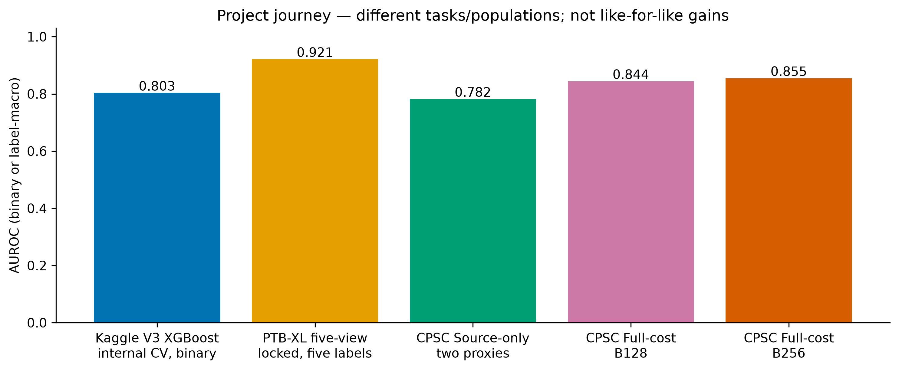
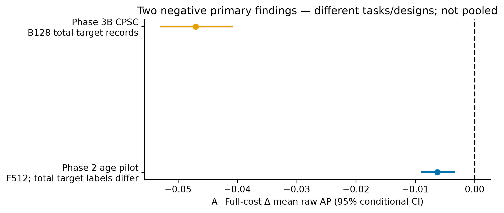
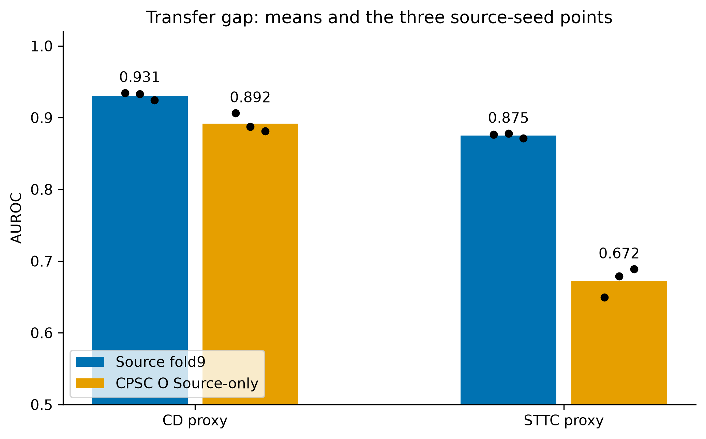
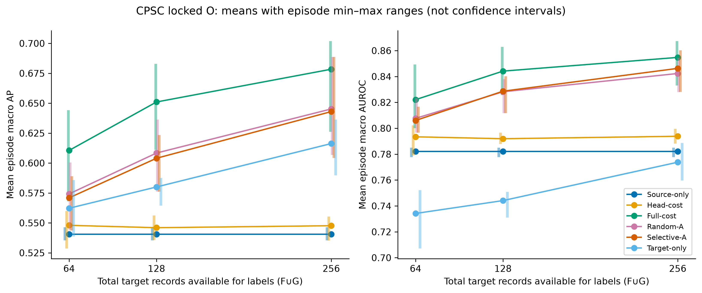
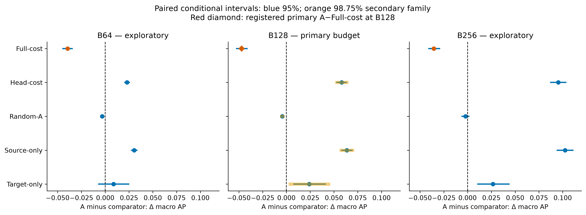
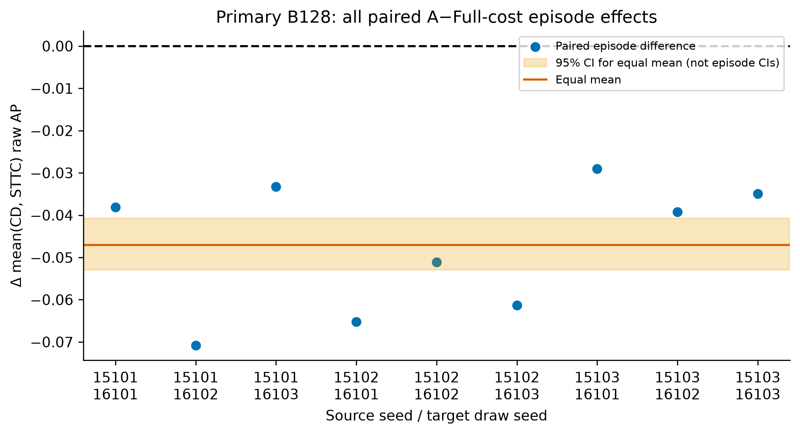
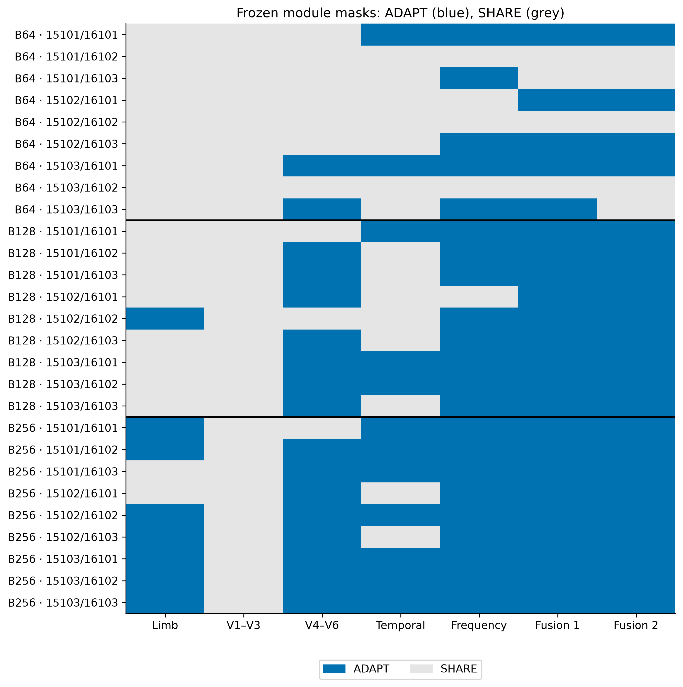

# Project results summary: multiview ECG annotation classification and selective transfer

## Project in one paragraph

This project investigates whether a structured multiview representation can support useful classification and evidence-guided adaptation. It moves from binary cross-sectional tabular cardiovascular labels to multilabel ECG annotation classification, then compares selective module updates with conventional fine-tuning under matched target-label access. The ECG backbone separates limb, early and late precordial, learned temporal and frequency views, followed by selectable fusion modules and an always-trainable head. The implemented MMD/permutation selector is a re-engineering inspired by DMV-MAT, not proof of faithful replication of every published component. The scientific endpoint is detection/classification of annotations on recorded ECGs, not prediction of future clinical events. Architecture and provenance: [ECG_ARCHITECTURE](ECG_ARCHITECTURE.md), [SELECTOR_IMPLEMENTATION_REPORT](phase2/SELECTOR_IMPLEMENTATION_REPORT.md). This summary reads existing aggregate JSON/Markdown only; no participant-level data, predictions, models or ledgers were opened.

## Chapter 1 — Kaggle: a tabular ranking plateau, not a universal performance ceiling

|Evaluation basis|Model/procedure|AP|AUROC|Source path and key|
|---|---|---|---|---|
|V1 fixed test|Five-view MLP|0.76560|0.75330|[../cvd-70k-multiview-benchmark/docs/results.md](../../cvd-70k-multiview-benchmark/docs/results.md) → `table[row=Five-view MLP][column=1]; AUROC column2`|
|V1 fixed test|Flat MLP|0.76510|0.75250|[../cvd-70k-multiview-benchmark/docs/results.md](../../cvd-70k-multiview-benchmark/docs/results.md) → `table[row=Flat MLP][column=1]; AUROC column2`|
|V1 fixed test|XGBoost|0.76960|0.75670|[../cvd-70k-multiview-benchmark/docs/results.md](../../cvd-70k-multiview-benchmark/docs/results.md) → `table[row=XGBoost][column=1]; AUROC column2`|
|V2 nested internal CV|multiview/selected|0.78387|0.80136|[../cvd-70k-multiview-benchmark/docs/v2/OPTIMIZATION_RESULTS.md](../../cvd-70k-multiview-benchmark/docs/v2/OPTIMIZATION_RESULTS.md) → `table[row=multiview/selected][column=1]; AUROC column2`|
|V2 nested internal CV|mlp/selected|0.78333|0.79967|[../cvd-70k-multiview-benchmark/docs/v2/OPTIMIZATION_RESULTS.md](../../cvd-70k-multiview-benchmark/docs/v2/OPTIMIZATION_RESULTS.md) → `table[row=mlp/selected][column=1]; AUROC column2`|
|V2 nested internal CV|xgboost/selected|0.78431|0.80222|[../cvd-70k-multiview-benchmark/docs/v2/OPTIMIZATION_RESULTS.md](../../cvd-70k-multiview-benchmark/docs/v2/OPTIMIZATION_RESULTS.md) → `table[row=xgboost/selected][column=1]; AUROC column2`|
|V3 internal folds|flat_attention_matched|0.78305|0.80007|[../cvd-70k-multiview-benchmark/docs/v3/PREDICTIVE_OPTIMIZATION.md](../../cvd-70k-multiview-benchmark/docs/v3/PREDICTIVE_OPTIMIZATION.md) → `table[row=flat_attention_matched][column=1]; AUROC column2`|
|V3 internal folds|selected_xgboost|0.78629|0.80338|[../cvd-70k-multiview-benchmark/docs/v3/PREDICTIVE_OPTIMIZATION.md](../../cvd-70k-multiview-benchmark/docs/v3/PREDICTIVE_OPTIMIZATION.md) → `table[row=selected_xgboost][column=1]; AUROC column2`|
|V3 internal folds|selected_lightgbm|0.78630|0.80282|[../cvd-70k-multiview-benchmark/docs/v3/PREDICTIVE_OPTIMIZATION.md](../../cvd-70k-multiview-benchmark/docs/v3/PREDICTIVE_OPTIMIZATION.md) → `table[row=selected_lightgbm][column=1]; AUROC column2`|
|V3 internal folds|age-spline five-view|0.78418|0.80080|[../cvd-70k-multiview-benchmark/docs/v3/ABLATION_RESULTS.md](../../cvd-70k-multiview-benchmark/docs/v3/ABLATION_RESULTS.md) → `table[row=age_spline][column=1]; AUROC column2`|
|V4 locked internal contexts|A-age|0.78462|0.80148|[../cvd-70k-v4-synthetic/results/v4/evaluation/summary.json](../../cvd-70k-v4-synthetic/results/v4/evaluation/summary.json) → `/leaderboard/A-age/raw_fixed_050/{ap,auroc}`|
|V4 locked internal contexts|NewSelected|0.78449|0.80145|[../cvd-70k-v4-synthetic/results/v4/evaluation/summary.json](../../cvd-70k-v4-synthetic/results/v4/evaluation/summary.json) → `/leaderboard/NewSelected/raw_fixed_050/{ap,auroc}`|
|V4 locked internal contexts|C|0.78465|0.80173|[../cvd-70k-v4-synthetic/results/v4/evaluation/summary.json](../../cvd-70k-v4-synthetic/results/v4/evaluation/summary.json) → `/leaderboard/C/raw_fixed_050/{ap,auroc}`|
|V4 locked internal contexts|Flat-raw|0.78474|0.80074|[../cvd-70k-v4-synthetic/results/v4/evaluation/summary.json](../../cvd-70k-v4-synthetic/results/v4/evaluation/summary.json) → `/leaderboard/Flat-raw/raw_fixed_050/{ap,auroc}`|
|V4 locked internal contexts|XGBoost|0.78481|0.80242|[../cvd-70k-v4-synthetic/results/v4/evaluation/summary.json](../../cvd-70k-v4-synthetic/results/v4/evaluation/summary.json) → `/leaderboard/XGBoost/raw_fixed_050/{ap,auroc}`|

Historical versions use different evaluation roles: V1 is its fixed held-out test; V2 uses nested grouped internal cross-validation; V3 uses grouped outer contexts with development holdouts; V4 uses locked internal contexts from the original V1 training pool. The scores cannot be subtracted across versions as paired improvements. The selected XGBoost V3 AUROC is the descriptive Kaggle point shown in the journey figure, not a newly chosen deployment model. V3 LightGBM has the slightly larger selected-tree AP point estimate; those metrics need not identify the same tree family. Table rows preserve the source precision, including rounded Markdown values.

The defensible conclusion is **no reproducible broad AP advantage from the multiview structure on these predictors**, not literal absence of every gain. V1 five-view−flat AP has interval [-0.00263, 0.00381] ([../cvd-70k-multiview-benchmark/results/aggregate/bootstrap_primary.json](../../cvd-70k-multiview-benchmark/results/aggregate/bootstrap_primary.json) → `/ap_difference_vs_mlp~1standard/multiview~1standard/ci95`). V2 optimization improves its matched legacy reference, but multiview−flat AP is inconclusive; its AUROC contrast is positive in that internal comparison ([../cvd-70k-multiview-benchmark/docs/v2/OPTIMIZATION_RESULTS.md](../../cvd-70k-multiview-benchmark/docs/v2/OPTIMIZATION_RESULTS.md) → `paired-comparison table`). In V4 the prespecified NewSelected−A-age AP contrast is -0.00013, CI [-0.00222, 0.00199] ([../cvd-70k-v4-synthetic/results/v4/evaluation/summary.json](../../cvd-70k-v4-synthetic/results/v4/evaluation/summary.json) → `/primary/{ap_difference,ap_95_ci}`). Neither numerical embeddings nor modular ensembling established the registered primary AP improvement. This is evidence of a local plateau under tested features/budgets, not an information-theoretic limit or medical impossibility claim.

## Chapter 2 — PTB-XL locked ECG classification

|Procedure|Macro AP|Macro AUROC|95% AUROC CI|
|---|---|---|---|
|flat_cnn|0.80657|0.91733|[0.90974, 0.92440]|
|multiview|0.81405|0.92139|[0.91396, 0.92852]|
|multiview_aug|0.81698|0.92068|[0.91311, 0.92787]|
|xresnet101|0.82759|0.92985|[0.92306, 0.93617]|

Source: [results/locked_metrics.json](../results/locked_metrics.json) → `/summary/<procedure>/{macro_ap,macro_auroc,auroc_ci95}`. These are locked official fold-10 results, averaging seed-wise metrics, not validation scores or a probability ensemble. The two training seeds are identified in `/runs` and the original report ([results/locked_metrics.json](../results/locked_metrics.json) → `/runs`). Five-view−flat ΔAUROC is 0.00406, with the registered Bonferroni97.5% CI [0.00009, 0.00786]; ΔAP is 0.00748, exploratory95% CI [-0.00078, 0.01600] ([results/locked_metrics.json](../results/locked_metrics.json) → `/comparisons/multiview-minus-flat_cnn`). Thus there is limited conditional AUROC evidence over the matched flat control, while AP superiority remains inconclusive. The lower adjusted AUROC bound is near zero and omits retraining/selection uncertainty.

The stronger XResNet pipeline remains ahead of five-view on both ranking metrics: see `/comparisons/multiview-minus-xresnet101`. It uses its own registered inference pipeline; the lightweight CNNs use full-record inference. The augmentation variant did not establish an improvement over the unaugmented network (`/comparisons/multiview_aug-minus-multiview`). These observations justify a modular backbone as a research instrument, not a claim that multiview is the best ECG architecture. The original paper's benchmark is context, not an achieved transfer target or an independent paired comparator.

## Chapter 3 — Phase 2 internal age-subgroup pilot

On the newly trained, patient-disjoint source/target age roles, primary A−Full-cost at F512 was ΔAP -0.00628,95% CI [-0.00901, -0.00335]; ΔAUROC -0.00316,95% CI [-0.00464, -0.00170] ([results/phase2f/BOOTSTRAP_SUMMARIES.json](../results/phase2f/BOOTSTRAP_SUMMARIES.json) → `/primary/{ap,auroc}`). The intervals favor Full-cost for these fitted procedures; the draw-specific AP differences differ in direction (`/primary/by_draw`), so the mean is not evidence of uniform episode behavior.

|Secondary contrast|ΔAP|95% CI|Bonferroni99% CI|
|---|---|---|---|
|A_minus_Full_F|-0.00688|[-0.01070, -0.00284]|[-0.01189, -0.00156]|
|A_minus_Head_cost|0.00052|[-0.00107, 0.00218]|[-0.00156, 0.00273]|
|A_minus_Random_A|0.00099|[-0.00043, 0.00249]|[-0.00089, 0.00300]|
|A_minus_raw_Source_only|0.00099|[-0.00043, 0.00249]|[-0.00089, 0.00300]|
|B_minus_A|0.00035|[-0.00055, 0.00124]|[-0.00081, 0.00152]|

Source: [results/phase2f/BOOTSTRAP_SUMMARIES.json](../results/phase2f/BOOTSTRAP_SUMMARIES.json) → `/secondary/<contrast>/ap`. Head/random/source and B−A comparisons remain inconclusive; Full-F is a different label-access comparison. Epoch-zero selection frequently retained source weights and source-only already generalized strongly ([docs/phase2/INTERNAL_PILOT_LOCKED_EVALUATION_RESULTS.md](../docs/phase2/INTERNAL_PILOT_LOCKED_EVALUATION_RESULTS.md) → `Selector, epoch-zero and negative-transfer observations`). This describes checkpoint behavior, not the cause of failure. At F512 the primary matched access total is1,024 target participants, including F, evidence, stopping and calibration; at F128 it is640. These are not512- or128-total-label conditions ([docs/phase2/INTERNAL_PILOT_LOCKED_EVALUATION_RESULTS.md](../docs/phase2/INTERNAL_PILOT_LOCKED_EVALUATION_RESULTS.md) → `Label and compute fairness`).

## Chapter 4 — Cross-dataset annotation-proxy transfer

### Feasibility informed the target choice

|Target domain|Five-view proxy-matched macro AUROC DROP|Recorded feasibility verdict|
|---|---|---|
|CPSC|-0.09866|SUITABLE|
|Chapman-Ningbo|-0.03598|BORDERLINE|
|Georgia|-0.05199|SUITABLE|

Source: [results/phase3a/METRICS.json](../results/phase3a/METRICS.json) → `/verdicts/<domain>/{macro_proxy_matched_AUROC_DROP,status}`. These earlier FEAS results used historical source checkpoints and proxy-matched fold9 labels. They are not the later freshly trained source models' O results. CPSC was selected after feasibility inspection; this history reduces confirmatory strength. Georgia was also suitable by the adopted rule; Chapman–Ningbo was borderline. A drop can reflect reporting/label mismatch as well as waveform distribution shift.

### Fresh sources show an asymmetric transfer gap

|Label|Mean fold9 AUROC|Mean O Source-only AUROC|Mean O−fold9|
|---|---|---|---|
|CD-proxy|0.93058|0.89173|-0.03885|
|STTC-proxy|0.87515|0.67233|-0.20282|

Source: [results/phase3b_eval_v2/SOURCE_FOLD9_TRANSFER_REFERENCE.json](../results/phase3b_eval_v2/SOURCE_FOLD9_TRANSFER_REFERENCE.json) → `/rows/*; arithmetic means within label across source seeds`. Fold9 selected source checkpoints, so it is an optimistic development reference. Prevalence differs and AP cannot measure a pure signal-shift effect. All per-seed points remain visible below.

|Label|Fold9 AP|O Source-only AP|O−fold9 AP|Fold9 AP baseline|O AP baseline|
|---|---|---|---|---|---|
|CD-proxy|0.83823|0.74781|-0.09043|0.22088|0.26632|
|STTC-proxy|0.56606|0.33322|-0.23284|0.17102|0.24404|

Source: [results/phase3b_eval_v2/SOURCE_FOLD9_TRANSFER_REFERENCE.json](../results/phase3b_eval_v2/SOURCE_FOLD9_TRANSFER_REFERENCE.json) → `/rows/*/{source_fold9_AP,O_AP,O_minus_fold9_AP,source_fold9_prevalence,O_prevalence}; means by label`. AP drops are prevalence-dependent.

### Complete budget comparison

|Total F∪G budget|Procedure|Mean macro AP|Mean macro AUROC|
|---|---|---|---|
|64|Source-only|0.54051|0.78203|
|64|Head-cost|0.54797|0.79343|
|64|Full-cost|0.61053|0.82212|
|64|Random-A|0.57419|0.80764|
|64|Selective-A|0.57091|0.80603|
|64|Target-only|0.56222|0.73418|
|128|Source-only|0.54051|0.78203|
|128|Head-cost|0.54599|0.79195|
|128|Full-cost|0.65101|0.84417|
|128|Random-A|0.60835|0.82819|
|128|Selective-A|0.60399|0.82865|
|128|Target-only|0.58000|0.74412|
|256|Source-only|0.54051|0.78203|
|256|Head-cost|0.54765|0.79384|
|256|Full-cost|0.67840|0.85477|
|256|Random-A|0.64519|0.84234|
|256|Selective-A|0.64299|0.84630|
|256|Target-only|0.61627|0.77379|

Source: [results/phase3b_eval_v2/AGGREGATE_METRICS.json](../results/phase3b_eval_v2/AGGREGATE_METRICS.json) → `/methods/B<budget>~1<method>/macro/{AP,AUROC}`. Source-only averages the source-seed metrics; each adapted row averages the paired source×draw episodes. Target-only is the registered scratch-training control, not an optimally tuned target-only benchmark. Budget includes both fitting and selector-evidence records: selective and random masks were determined on G, then all adapted arms fit F∪G. There is no hidden target stopping or calibration set in this design. Terminal checkpoints are fixed; these labels cannot be compared directly with Phase2's larger all-role costs ([docs/phase2/INTERNAL_PILOT_LOCKED_EVALUATION_RESULTS.md](../docs/phase2/INTERNAL_PILOT_LOCKED_EVALUATION_RESULTS.md) → `Label and compute fairness`; [Phase3B development report](phase3/PHASE3B_DEVELOPMENT_RESULTS.md)).

Full-cost at B128 recovers ΔAP 0.11049 and ΔAUROC 0.06214 over Source-only ([results/phase3b_eval_v2/NEGATIVE_TRANSFER_AND_RECOVERY.json](../results/phase3b_eval_v2/NEGATIVE_TRANSFER_AND_RECOVERY.json) → `/recovery/B128~1full_cost-minus-source_only`). These descriptive recovery contrasts do not prove clinical gap closure or isolate hospital causality. No interpolation identifies the minimum sufficient label budget.

|Budget / recovery contrast|ΔAP|ΔAUROC|
|---|---|---|
|B128/full_cost-minus-source_only|0.11049|0.06214|
|B128/head_cost-minus-source_only|0.00548|0.00992|
|B256/full_cost-minus-source_only|0.13788|0.07274|
|B256/head_cost-minus-source_only|0.00713|0.01181|
|B64/full_cost-minus-source_only|0.07001|0.04009|
|B64/head_cost-minus-source_only|0.00746|0.01140|

Source: [results/phase3b_eval_v2/NEGATIVE_TRANSFER_AND_RECOVERY.json](../results/phase3b_eval_v2/NEGATIVE_TRANSFER_AND_RECOVERY.json) → `/recovery/<contrast>/{delta_AP,delta_AUROC}`. All recovery contrasts are descriptive, without additional superiority claims.

### Primary and secondary comparisons

|Contrast|Δ mean raw AP|Ordinary95% CI|B128 secondary Bonferroni98.75% CI|
|---|---|---|---|
|B128/A-minus-full_cost|-0.04702|[-0.05299, -0.04072]|not in B128 secondary family|
|B128/A-minus-head_cost|0.05800|[0.05256, 0.06347]|[0.05125, 0.06514]|
|B128/A-minus-random_a|-0.00436|[-0.00622, -0.00241]|[-0.00678, -0.00196]|
|B128/A-minus-source_only|0.06348|[0.05758, 0.06955]|[0.05592, 0.07121]|
|B128/A-minus-target_only_cost|0.02399|[0.00725, 0.04149]|[0.00238, 0.04592]|
|B256/A-minus-full_cost|-0.03541|[-0.04142, -0.02884]|not in B128 secondary family|
|B256/A-minus-head_cost|0.09534|[0.08679, 0.10386]|not in B128 secondary family|
|B256/A-minus-random_a|-0.00220|[-0.00643, 0.00202]|not in B128 secondary family|
|B256/A-minus-source_only|0.10247|[0.09355, 0.11148]|not in B128 secondary family|
|B256/A-minus-target_only_cost|0.02672|[0.01001, 0.04419]|not in B128 secondary family|
|B64/A-minus-full_cost|-0.03962|[-0.04509, -0.03414]|not in B128 secondary family|
|B64/A-minus-head_cost|0.02294|[0.02009, 0.02592]|not in B128 secondary family|
|B64/A-minus-random_a|-0.00329|[-0.00468, -0.00187]|not in B128 secondary family|
|B64/A-minus-source_only|0.03039|[0.02709, 0.03392]|not in B128 secondary family|
|B64/A-minus-target_only_cost|0.00868|[-0.00753, 0.02537]|not in B128 secondary family|

Source: [results/phase3b_eval_v2/BOOTSTRAP_SUMMARIES.json](../results/phase3b_eval_v2/BOOTSTRAP_SUMMARIES.json) → `/comparisons/<contrast>/{delta_AP,CI95,Bonferroni_CI9875}`. Only B128 A−Full-cost is primary; other budgets are exploratory. All nine primary episode differences are negative (`/comparisons/B128~1A-minus-full_cost/episodes`). The intervals are conditional paired record/known-group bootstraps with shared whole-label-vector weights, not independent-clinical-population inference. The stored plan uses10,000 draws, seed78701; all are valid for the primary result and none were redrawn ([results/phase3b_eval_v2/BOOTSTRAP_SUMMARIES.json](../results/phase3b_eval_v2/BOOTSTRAP_SUMMARIES.json) → `/{draws,seed}; /comparisons/B128~1A-minus-full_cost/CI95`). A exceeds head-only and source-only, but underperforms Full-cost and Random-A on AP at the primary budget. This fails the stipulated evidence-guided-selection interpretation.

### Masks, abstention, negative transfer and execution

|Budget|Mean ADAPT modules|All-SHARE episodes|Fusion1 ADAPT fraction|Fusion2 ADAPT fraction|
|---|---|---|---|---|
|64|2.00000|3|0.55556|0.44444|
|128|4.11111|0|1.00000|1.00000|
|256|5.44444|0|1.00000|1.00000|

Source: [results/phase3b/DEVELOPMENT_SUMMARY.json](../results/phase3b/DEVELOPMENT_SUMMARY.json) → `/budgets/<budget>/{mean_ADAPT,all_SHARE,module_ADAPT_frequency}`. All registered masks are preserved in [MASK_INVENTORY.json](../results/summary/MASK_INVENTORY.json), with exact `/episodes/<index>/mask` citations into [results/phase3b/MODULE_EVIDENCE.json](../results/phase3b/MODULE_EVIDENCE.json). The early-precordial encoder remains SHARE throughout; fusion ADAPT is common but not universal. All-SHARE fallback remains in the comparisons rather than being discarded. Larger support changes masks, but mask stability is not predictive benefit.

|Budget/procedure|AP below paired Source-only|Mean AP−Source-only|
|---|---|---|
|B128/full_cost|0/9|0.11049|
|B128/head_cost|0/9|0.00548|
|B128/random_a|0/9|0.06783|
|B128/selective_a|0/9|0.06348|
|B256/full_cost|0/9|0.13788|
|B256/head_cost|1/9|0.00713|
|B256/random_a|0/9|0.10467|
|B256/selective_a|0/9|0.10247|
|B64/full_cost|0/9|0.07001|
|B64/head_cost|2/9|0.00746|
|B64/random_a|0/9|0.03368|
|B64/selective_a|0/9|0.03039|

Source: [results/phase3b_eval_v2/NEGATIVE_TRANSFER_AND_RECOVERY.json](../results/phase3b_eval_v2/NEGATIVE_TRANSFER_AND_RECOVERY.json) → `/negative_transfer/<procedure>/{AP_worse_count,episodes,mean_delta_AP}`. Target-only is not counted as negative transfer because it does not initialize from source. These episode counts are descriptive and dependent, not repeated independent trials. Actual fits used121/144;17 of135 target logical procedures alias existing artifacts ([results/phase3b/DEVELOPMENT_SUMMARY.json](../results/phase3b/DEVELOPMENT_SUMMARY.json) → `/{attempts,ceiling,aliases,target_logical_procedures}`). Alias savings never funded extra search.

## What the results establish

1. Tabular multiview did not establish a broad AP advantage over strong flat/tree controls; the local AUROC plateau does not imply a universal ceiling (Kaggle evidence above).
2. Five-view ECG improves the matched flat comparator's AUROC conditionally, while its AP interval crosses zero; the stronger XResNet remains superior under the registered benchmark comparisons ([results/locked_metrics.json](../results/locked_metrics.json) → `/comparisons`).
3. Source-only performance can degrade substantially across annotation-proxy datasets, especially for STTC in CPSC ([results/phase3b_eval_v2/SOURCE_FOLD9_TRANSFER_REFERENCE.json](../results/phase3b_eval_v2/SOURCE_FOLD9_TRANSFER_REFERENCE.json) → `/rows`).
4. Limited target supervision substantially improves full fine-tuning's ranking over Source-only in CPSC ([results/phase3b_eval_v2/NEGATIVE_TRANSFER_AND_RECOVERY.json](../results/phase3b_eval_v2/NEGATIVE_TRANSFER_AND_RECOVERY.json) → `/recovery`).
5. Neither locked transfer study supports selective superiority over matched Full-cost; CPSC also supplies evidence against an AP advantage over parameter-matched Random-A ([results/phase2f/BOOTSTRAP_SUMMARIES.json](../results/phase2f/BOOTSTRAP_SUMMARIES.json) → `/primary`; [results/phase3b_eval_v2/BOOTSTRAP_SUMMARIES.json](../results/phase3b_eval_v2/BOOTSTRAP_SUMMARIES.json) → `/comparisons/B128~1A-minus-{full_cost,random_a}`).

**One-line conclusion:** A useful multiview ECG representation and a real transfer gap were demonstrated, but the tested evidence-guided freezing policy did not improve on fair conventional full fine-tuning.

## Exploratory interpretations — NOT TESTED

“Freezing precordial views hurts STTC transfer”, “this small model does not overfit, so Full-cost wins”, and “the selector needs at least20 labels while freezing helps only below that support” are hypotheses, not established mechanisms. Masks are not randomized per-module interventions; Full-cost differs in many updates; selected representations and geometry do not identify causal effects. The proposed support boundary is not estimated by these budgets. A better AUC on one metric or an increased ADAPT frequency cannot validate those explanations. A selector can detect shift yet select harmful constraints; this remains a possible explanation rather than a proved cause.

## Thesis claims and limitations

The thesis can claim reproducible implementation, bounded matched-label experiments, limited conditional representation benefits, and two negative primary selective-versus-full findings. It cannot claim faithful replication of all DMV-MAT components, selective-transfer superiority, equivalence to random selection, general clinical transfer, diagnostic deployment utility, independently verified disease negatives, or future-event prediction. The distinction between annotation classification and clinical diagnosis must remain explicit in title and abstract.

CinC target patient identities are unknown: bootstrap units are records/known duplicate groups, not verified patients. The study is CPSC-only for adaptation; source-target linkage and near-duplicates are not fully excluded. Codes are annotation proxies, absence is not clinically adjudicated negative, and incomplete harmonization can produce apparent shift. Truncation affected2436 O recordings;0 were excluded as short before scoring ([results/phase3b_eval/HEADER_ONLY_SUMMARY.json](../results/phase3b_eval/HEADER_ONLY_SUMMARY.json) → `/{truncated_first10,excluded_short}`). The retained segment may omit findings annotated on the full tracing. FEAS informed target/design selection; reused PTB-XL benchmarks and validation selection also limit independence. Phase2 O overlaps an earlier audited holdout by790 people, disclosed before evaluation ([docs/phase2/INTERNAL_PILOT_LOCKED_EVALUATION_RESULTS.md](../docs/phase2/INTERNAL_PILOT_LOCKED_EVALUATION_RESULTS.md) → `Population, provenance and evidence limits`).

There were2 Phase3B O reads: a failed decoder read produced zero observed labels, then an explicit human-authorized corrected read used the already sealed unchanged predictions. The pre-access validation requirement was prospectively corrected to frozen-reference agreement on711 R records plus live-adapter agreement on3,859 R records; no O feedback informed that change ([V2 disclosure](phase3/PHASE3B_LOCKED_EVALUATION_RESULTS_V2.md), pre-access revision and decoder-validation receipts cited there). The failed V1 outputs are superseded, not deleted. No new predictions or fitting occurred in the correction ([results/phase3b_eval_v2/CORRECTED_FINAL_VERIFICATION_RECEIPT.json](../results/phase3b_eval_v2/CORRECTED_FINAL_VERIFICATION_RECEIPT.json) → `/{O_outcome_access_count,corrected_O_access_count,new_inference_runs,new_predictor_fits}`). Conditional intervals omit retraining and policy-selection uncertainty; seeds are not new clinical cohorts. Neither a negative primary contrast nor an inconclusive secondary contrast is universal proof that selective adaptation never helps.

## Possible future work — not executed

A separately preregistered source/target alignment experiment could test MK-MMD-aligned pretraining with unlabelled target ECGs, then assess module-selection benefit against strong conventional regularization. This untested part must be distinguished from the current selector's MMD evidence; alignment must not silently be added to the existing results. The faithful-paper arm was deferred in the adopted Phase3B protocol ([method gates](phase3/PHASE3B_METHOD_AND_EVIDENCE_GATES.md)). Cross-cohort work first needs defensible label-negative semantics, participant linkage and overlap control. If future-event “prediction” is required, investigate whether resources such as MIMIC-IV-ECG or CODE-15% provide suitable longitudinal outcomes and permissions; neither resource has been audited or evaluated here, and their names alone do not establish future-outcome availability. Write-up can present the negative result without launching another experiment.

## Claim verification

|Claim|Status|Verified finding / correction|Aggregate evidence|
|---|---|---|---|
|1|VERIFIED|CD-proxy: 0.93058 → 0.89173, DROP -0.03885; STTC-proxy: 0.87515 → 0.67233, DROP -0.20282; macro AP/AUROC 0.54051/0.78203|[results/phase3b_eval_v2/SOURCE_FOLD9_TRANSFER_REFERENCE.json](../results/phase3b_eval_v2/SOURCE_FOLD9_TRANSFER_REFERENCE.json) → `/rows/*/{source_fold9_AUROC,O_AUROC}; arithmetic means`; [results/phase3b_eval_v2/AGGREGATE_METRICS.json](../results/phase3b_eval_v2/AGGREGATE_METRICS.json) → `/methods/B128~1source_only/macro`|
|2|VERIFIED|B128/source_only: 0.54051/0.78203; B128/target_only_cost: 0.58000/0.74412; B128/full_cost: 0.65101/0.84417; B256/full_cost: 0.67840/0.85477|[results/phase3b_eval_v2/AGGREGATE_METRICS.json](../results/phase3b_eval_v2/AGGREGATE_METRICS.json) → `/methods/{listed keys}/macro/{AP,AUROC}`|
|3|VERIFIED|Full-cost B128−Source-only: ΔAP 0.11049; ΔAUROC 0.06214|[results/phase3b_eval_v2/NEGATIVE_TRANSFER_AND_RECOVERY.json](../results/phase3b_eval_v2/NEGATIVE_TRANSFER_AND_RECOVERY.json) → `/recovery/B128~1full_cost-minus-source_only`|
|4|VERIFIED|B128 ΔAP -0.04702, CI [-0.05299, -0.04072]; all 9 episode AP effects negative (9/9). B64/B256: -0.03962/-0.03541|[results/phase3b_eval_v2/BOOTSTRAP_SUMMARIES.json](../results/phase3b_eval_v2/BOOTSTRAP_SUMMARIES.json) → `/comparisons/B{64,128,256}~1A-minus-full_cost; /episodes`|
|5|VERIFIED|A−head_cost: 0.05800; adjusted CI [0.05125, 0.06514]; A−random_a: -0.00436; adjusted CI [-0.00678, -0.00196]; A−source_only: 0.06348; adjusted CI [0.05592, 0.07121]; A−target_only_cost: 0.02399; adjusted CI [0.00238, 0.04592]. A is below Random-A on AP; this is not equivalence.|[results/phase3b_eval_v2/BOOTSTRAP_SUMMARIES.json](../results/phase3b_eval_v2/BOOTSTRAP_SUMMARIES.json) → `/comparisons/B128~1A-minus-{head_cost,random_a,source_only,target_only_cost}`|
|6|CORRECTED|view_2 SHARE 27/27; Fusion1 ADAPT 23/27, Fusion2 22/27. Both always ADAPT at B128/B256; not at B64.|[results/phase3b/MODULE_EVIDENCE.json](../results/phase3b/MODULE_EVIDENCE.json) → `/episodes/*/mask; counts derived without labels`|
|7|VERIFIED|Phase2 ΔAP -0.00628, CI [-0.00901, -0.00335]|[results/phase2f/BOOTSTRAP_SUMMARIES.json](../results/phase2f/BOOTSTRAP_SUMMARIES.json) → `/primary/ap`|
|8|VERIFIED|Locked five-view AUROC/AP 0.92139/0.81405; flat 0.91733/0.80657; adjusted AUROC CI [0.00009, 0.00786]; AP CI includes zero.|[results/locked_metrics.json](../results/locked_metrics.json) → `/summary/{multiview,flat_cnn}; /comparisons/multiview-minus-flat_cnn`|

## Figure provenance and source-file index

Every displayed data value, interval, seed-point input and mask state has an explicit source path/key in [FIGURE_DATA_PROVENANCE.json](../results/summary/FIGURE_DATA_PROVENANCE.json). Arithmetic is limited to averages/ranges/counts of existing aggregate results; no metrics are recomputed from participant-level labels or predictions. The machine-readable source index records source hashes. Sources from adjacent tabular workspaces are read-only references and are not copied or modified; availability outside this checkout is required to rebuild those rows.

- **project_journey**: `Kaggle value is descriptive highest selected XGBoost AUROC across historical versions, not a new model choice.`. All plotted numbers and their exact source keys are listed in [FIGURE_DATA_PROVENANCE.json](../results/summary/FIGURE_DATA_PROVENANCE.json), key `/project_journey/numerical_data`.
- **transfer_gap**: `Exact per-seed values are the inputs to each documented mean.`. All plotted numbers and their exact source keys are listed in [FIGURE_DATA_PROVENANCE.json](../results/summary/FIGURE_DATA_PROVENANCE.json), key `/transfer_gap/numerical_data`.
- **label_efficiency**: `Nine adapted episodes; three unique Source-only seeds repeated by design. Budget keys from DEVELOPMENT_SUMMARY.json/budgets.`. All plotted numbers and their exact source keys are listed in [FIGURE_DATA_PROVENANCE.json](../results/summary/FIGURE_DATA_PROVENANCE.json), key `/label_efficiency/numerical_data`.
- **contrast_forest**: `All adopted contrasts and budgets. Bonferroni intervals only for the four B128 secondary contrasts.`. All plotted numbers and their exact source keys are listed in [FIGURE_DATA_PROVENANCE.json](../results/summary/FIGURE_DATA_PROVENANCE.json), key `/contrast_forest/numerical_data`.
- **primary_episodes**: `Seed identities are in the corresponding episode objects, not patient identifiers.`. All plotted numbers and their exact source keys are listed in [FIGURE_DATA_PROVENANCE.json](../results/summary/FIGURE_DATA_PROVENANCE.json), key `/primary_episodes/numerical_data`.
- **mask_heatmap**: `All registered masks, no outcome-selected subset. Zero/one colour encodes SHARE/ADAPT, not numeric evidence strength.`. All plotted numbers and their exact source keys are listed in [FIGURE_DATA_PROVENANCE.json](../results/summary/FIGURE_DATA_PROVENANCE.json), key `/mask_heatmap/numerical_data`.
- **phase2_vs_phase3b**: `No cross-study hypothesis test or meta-analysis; label budgets and source replication differ.`. All plotted numbers and their exact source keys are listed in [FIGURE_DATA_PROVENANCE.json](../results/summary/FIGURE_DATA_PROVENANCE.json), key `/phase2_vs_phase3b/numerical_data`.

- **ecg**: [results/locked_metrics.json](../results/locked_metrics.json); SHA256 `96d48da251496fc9e7a07d68e3bd6e3c0f4b207486ed3a06121f7a0214c94098`.
- **p2**: [results/phase2f/BOOTSTRAP_SUMMARIES.json](../results/phase2f/BOOTSTRAP_SUMMARIES.json); SHA256 `f92b2b1652e616826022f4d01bedac76f1e72d3139845a2311e442e79b50de82`.
- **p2abs**: [results/phase2f/AGGREGATE_COMPARISON.json](../results/phase2f/AGGREGATE_COMPARISON.json); SHA256 `ae6d29454664123ffa682bab6b5d8c308d75ec6290dc88d50dfe944065e912ce`.
- **p2doc**: [docs/phase2/INTERNAL_PILOT_LOCKED_EVALUATION_RESULTS.md](../docs/phase2/INTERNAL_PILOT_LOCKED_EVALUATION_RESULTS.md); SHA256 `fcd385a7456cf3634448d99a32226884710778d7ba14e4b5fbe345e852103a6a`.
- **p3a**: [results/phase3a/METRICS.json](../results/phase3a/METRICS.json); SHA256 `b806f6c066ff4fab0979206ed375ff26eb59c6511d410b9128fe53b401b1d0d6`.
- **p3**: [results/phase3b_eval_v2/AGGREGATE_METRICS.json](../results/phase3b_eval_v2/AGGREGATE_METRICS.json); SHA256 `e149c76203aadfeaf3bb1339d2cd1002f551d282cebbeee4930197d861da5f46`.
- **ci**: [results/phase3b_eval_v2/BOOTSTRAP_SUMMARIES.json](../results/phase3b_eval_v2/BOOTSTRAP_SUMMARIES.json); SHA256 `d06e3330f0cc71faa25660a6fd7f8e9c2ef072275bb458e26df0692d9bec50ca`.
- **episodes**: [results/phase3b_eval_v2/PER_EPISODE_METRICS.json](../results/phase3b_eval_v2/PER_EPISODE_METRICS.json); SHA256 `89c13a16f781ba495677e49fbc213f4df68ce1d935883327bc0f3151cf9f4944`.
- **gap**: [results/phase3b_eval_v2/SOURCE_FOLD9_TRANSFER_REFERENCE.json](../results/phase3b_eval_v2/SOURCE_FOLD9_TRANSFER_REFERENCE.json); SHA256 `9fece52beec2da2d5c12f9053e5c7e94b252f4c89a52e7d9d1c9f6c54d997b70`.
- **recovery**: [results/phase3b_eval_v2/NEGATIVE_TRANSFER_AND_RECOVERY.json](../results/phase3b_eval_v2/NEGATIVE_TRANSFER_AND_RECOVERY.json); SHA256 `3089f7c83cc63adf4de2f27f8544f77a2f9129843f95d067e5013d00683fa36a`.
- **masks**: [results/phase3b/MODULE_EVIDENCE.json](../results/phase3b/MODULE_EVIDENCE.json); SHA256 `f0ed6d08dd041e6572ae01bdea02502678b56b2e5f311f8dd7bcaee2ce8701f3`.
- **dev**: [results/phase3b/DEVELOPMENT_SUMMARY.json](../results/phase3b/DEVELOPMENT_SUMMARY.json); SHA256 `7e3bf90388796fb4dc4c9ec39c4dbc4f75eafb8c31a7d4d2cfdfb40d3820a38d`.
- **receipt**: [results/phase3b_eval_v2/CORRECTED_FINAL_VERIFICATION_RECEIPT.json](../results/phase3b_eval_v2/CORRECTED_FINAL_VERIFICATION_RECEIPT.json); SHA256 `5d64a814d66d19aa826b1ce38bc2398d5c2d3fbc92a0dbeabdae5c26bf962978`.
- **headers**: [results/phase3b_eval/HEADER_ONLY_SUMMARY.json](../results/phase3b_eval/HEADER_ONLY_SUMMARY.json); SHA256 `a9249487b9d64e69d9e268b09ad07a1e6e307d5221a20affe388927fd4ab62c6`.
- **k1**: [../cvd-70k-multiview-benchmark/docs/results.md](../../cvd-70k-multiview-benchmark/docs/results.md); SHA256 `d6ee7215b1f1f1bee673bf5ae1e4b602a0d44e4be59a1a6d8e80e5bac4ef1899`.
- **k1ci**: [../cvd-70k-multiview-benchmark/results/aggregate/bootstrap_primary.json](../../cvd-70k-multiview-benchmark/results/aggregate/bootstrap_primary.json); SHA256 `5b023f7b8776a2d92ca3b754b995e1195671e7e45b543aeb0d46d4ec4e7d1744`.
- **k2**: [../cvd-70k-multiview-benchmark/docs/v2/OPTIMIZATION_RESULTS.md](../../cvd-70k-multiview-benchmark/docs/v2/OPTIMIZATION_RESULTS.md); SHA256 `ff1321b9280365daf456bce5c487af201adec23faefcecd02ebb2da0e4492b3e`.
- **k3**: [../cvd-70k-multiview-benchmark/docs/v3/PREDICTIVE_OPTIMIZATION.md](../../cvd-70k-multiview-benchmark/docs/v3/PREDICTIVE_OPTIMIZATION.md); SHA256 `4101daa0f2cccc995dcd9b6103e9c5d7ff4fdae4674fbeac513523729f16e41f`.
- **k3age**: [../cvd-70k-multiview-benchmark/docs/v3/ABLATION_RESULTS.md](../../cvd-70k-multiview-benchmark/docs/v3/ABLATION_RESULTS.md); SHA256 `27223faad14016328a693a55cff611d8d47da5550479fad822c635c3097d318b`.
- **k4**: [../cvd-70k-v4-synthetic/results/v4/evaluation/summary.json](../../cvd-70k-v4-synthetic/results/v4/evaluation/summary.json); SHA256 `67e89bbe3302bbcfb9bee396938c8772eae4e452d26fec9231807f6f84e76a68`.
- **k4doc**: [../cvd-70k-v4-synthetic/docs/v4/FINAL_EVALUATION_REPORT.md](../../cvd-70k-v4-synthetic/docs/v4/FINAL_EVALUATION_REPORT.md); SHA256 `a1ff0be984e337c6038d3820449f157b664d42ed4428b4c7f72a0035ec550d3d`.
