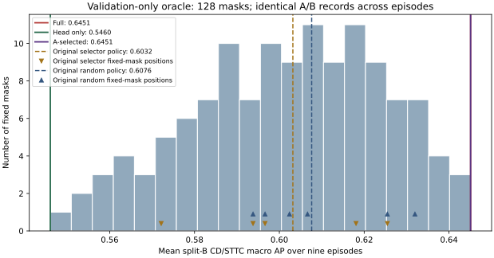
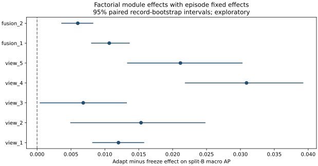

# Phase 4A — validation-only oracle module-mask results

Completed using only the adaptation bundle and new Phase 4 outputs. No CPSC test outcome, signal, prediction, metric or evaluation artifact was read. Test IDs were used only as an exclusion list during building; the bundle stores exclusion hashes, not those IDs.

## Protocol, bundle and validation split

[Prespecified protocol](ORACLE_MASK_PROTOCOL.md) · [Split counts and list hashes](VALIDATION_SPLIT_SUMMARY.json) · [Full aggregate results](ORACLE_MASK_AGGREGATES.json)

All 711 unique original label-draw records across budgets were excluded. The remaining adaptation pool has 3,148 records. A/B each contain 500 records, with zero mutual overlap, zero overlap with original label draws, and zero overlap with test IDs. All labels use the unchanged verified V2 CD/STTC mapping. Positive is recorded annotation, not an adjudicated clinical diagnosis.

| Split | Records | CD positives | STTC positives |
|---|---:|---:|---:|
| A | 500 | 126 (25.2%) | 135 (27.0%) |
| B | 500 | 127 (25.4%) | 135 (27.0%) |

The builder copied three existing source checkpoint files byte-for-byte. No new fitted checkpoint was saved. All source hashes/normalization matched; V2 labels and preprocessed signals matched the original development caches for all 711 original draw records. Record IDs, waveforms, labels and per-fit validation probabilities stay under gitignored `private/phase4_oracle_*` paths. SHA-256 values bind identities; they do not establish clinical validation.

## Reproducibility and execution

Full-mask repeated A/B predictions, final state and loss history were bitwise identical. Final state, drift and loss exactly matched the original Experiment 4 full-cost record. All reference-compatible masks were reconciled during fitting (31 distinct fits). Three prespecified random mask/episode fits from the parallel run were repeated serially with identical predictions, state, drift and history.

Completed **1152/1,152** distinct mask/episode fits; failed fits **0**. Five extra reproducibility fits. Three processes × original four threads. Main study wall time **6569.1 s**; summed fit durations **19603.4 s**, extra verification fits **54.0 s**. Summed concurrent durations are not elapsed wall time.

## Primary A-selected fixed mask versus full fine-tuning

A-selected mask **`1111111`** (index 127); bit order is view_1..view_5, fusion_1, fusion_2. One means ADAPT, zero SHARE; head always trainable. Ascending mask index resolves exact A ties.

Mean A macro AP: **0.639341**. Mean B macro AP: selected **0.645089**, full **0.645089**. Primary difference **+0.000000**, 95% paired record-bootstrap CI **[+0.000000, +0.000000]** (10000/10,000 valid replicates).

Requested rule match(es): **b**; specific requested category: **b**. Because the selected mask is the comparator itself, this [0, 0] interval is an identity comparison, not an equivalence test. Full fine-tuning also has the highest observed mean B AP over the entire fixed-mask grid. The nearest non-full mask is `1111110` (freeze fusion_2): B macro AP 0.642009, versus full 0.645089, a descriptive gap of -0.003081. The exact requested statements and overlap are preserved in the protocol. A CI including zero is inconclusive and cannot prove that no useful mask exists; a negative contrast of the A-selected mask cannot prove that every freezing choice hurts. This is conditional validation evidence, not a CPSC test result or an attribution of selector failure by itself.

| Label | Selected B AP | Full B AP | Difference | 95% paired CI |
|---|---:|---:|---:|---|
| CD | 0.777066 | 0.777066 | +0.000000 | [+0.000000, +0.000000] |
| STTC | 0.513113 | 0.513113 | +0.000000 | [+0.000000, +0.000000] |

## Top ten by mean split-A macro AP

Ranks are ordinal, with ascending mask index as tie breaker. B ranks are descriptive and were never used to select a model.

| A rank | Mask | A macro AP | B macro AP | A CD | A STTC | B CD | B STTC | B rank |
|---:|---|---:|---:|---:|---:|---:|---:|---:|
| 1 | `1111111` | 0.639341 | 0.645089 | 0.781948 | 0.496735 | 0.777066 | 0.513113 | 1 |
| 2 | `1111110` | 0.638934 | 0.642009 | 0.783649 | 0.494219 | 0.775744 | 0.508273 | 2 |
| 3 | `1111101` | 0.636263 | 0.640056 | 0.781689 | 0.490837 | 0.774052 | 0.506060 | 4 |
| 4 | `1111100` | 0.634318 | 0.635665 | 0.784227 | 0.484408 | 0.772924 | 0.498406 | 7 |
| 5 | `1101111` | 0.633340 | 0.640411 | 0.785189 | 0.481491 | 0.777695 | 0.503126 | 3 |
| 6 | `0111111` | 0.632266 | 0.637006 | 0.779363 | 0.485169 | 0.766514 | 0.507498 | 5 |
| 7 | `1101110` | 0.631796 | 0.636520 | 0.786530 | 0.477062 | 0.776546 | 0.496495 | 6 |
| 8 | `0111110` | 0.631223 | 0.632893 | 0.780538 | 0.481908 | 0.765096 | 0.500689 | 10 |
| 9 | `1101101` | 0.628609 | 0.634566 | 0.783101 | 0.474116 | 0.773701 | 0.495431 | 8 |
| 10 | `0111101` | 0.627060 | 0.631231 | 0.775343 | 0.478778 | 0.762800 | 0.499662 | 12 |

### CD-specific A rankings (secondary)

These rank the individual label on A; they do not replace the macro-selected primary mask.

| A rank | Mask | A AP | B AP | B rank |
|---:|---|---:|---:|---:|
| 1 | `1101010` | 0.789771 | 0.777558 | 4 |
| 2 | `1101011` | 0.789559 | 0.780536 | 1 |
| 3 | `1111010` | 0.787011 | 0.777457 | 5 |
| 4 | `1101110` | 0.786530 | 0.776546 | 7 |
| 5 | `1101000` | 0.786438 | 0.772943 | 14 |
| 6 | `1111011` | 0.786338 | 0.779459 | 2 |
| 7 | `1101001` | 0.785928 | 0.776253 | 8 |
| 8 | `1101100` | 0.785201 | 0.772553 | 16 |
| 9 | `1101111` | 0.785189 | 0.777695 | 3 |
| 10 | `1111001` | 0.784916 | 0.775948 | 9 |

CD: full A/B rank 18/6; head-only A/B rank 128/125.

### STTC-specific A rankings (secondary)

These rank the individual label on A; they do not replace the macro-selected primary mask.

| A rank | Mask | A AP | B AP | B rank |
|---:|---|---:|---:|---:|
| 1 | `1111111` | 0.496735 | 0.513113 | 1 |
| 2 | `1111110` | 0.494219 | 0.508273 | 3 |
| 3 | `1011111` | 0.492448 | 0.510912 | 2 |
| 4 | `1111101` | 0.490837 | 0.506060 | 6 |
| 5 | `1011110` | 0.488615 | 0.507649 | 4 |
| 6 | `1011101` | 0.485852 | 0.504435 | 8 |
| 7 | `0111111` | 0.485169 | 0.507498 | 5 |
| 8 | `1111100` | 0.484408 | 0.498406 | 14 |
| 9 | `0111110` | 0.481908 | 0.500689 | 11 |
| 10 | `1101111` | 0.481491 | 0.503126 | 9 |

STTC: full A/B rank 1/1; head-only A/B rank 128/128.

Full fine-tuning: A rank **1**, B rank **1**. Head-only: A rank **128**, B rank **128**.

Dashed selector/random lines are the original episode-varying policy means on B, not necessarily any single fixed mask. Their exact recorded mask identities and ranks are listed below. All fixed-mask means are available in the aggregate JSON.

## Per-episode A-selected oracle (secondary)

Mean B oracle-minus-full difference **-0.003698**, 95% paired CI **[-0.006208, -0.001041]**. Episode masks (source-major, draw-minor): `[124, 110, 127, 127, 79, 127, 126, 126, 127]`. Every episode mask is selected on its own A scores only. Reused B records and nine fitted models are not nine independent cohorts.

## Module effects

OLS: B macro AP ~ seven mask bits + episode fixed effects. The complete factorial design makes each coefficient equal its adapt-minus-freeze average across the other bits and episodes. CIs resample B records jointly across every fit, rather than treating 1,152 correlated AP measurements as independent observations. Seven exploratory intervals are not multiplicity-adjusted and are not causal clinical importance.

| Module | Adapt minus freeze | 95% paired record-bootstrap CI |
|---|---:|---|
| view_1 | +0.012007 | [+0.008138, +0.015798] |
| view_2 | +0.015337 | [+0.004896, +0.024842] |
| view_3 | +0.006810 | [+0.000388, +0.013253] |
| view_4 | +0.030900 | [+0.021807, +0.039275] |
| view_5 | +0.021151 | [+0.013281, +0.030312] |
| fusion_1 | +0.010646 | [+0.007977, +0.013672] |
| fusion_2 | +0.006005 | [+0.003577, +0.008294] |

## Original Experiment 4 selector and random masks

| Source seed | Draw seed | Selector mask | Its episode A/B rank | Random mask | Its episode A/B rank |
|---:|---:|---|---|---|---|
| 15101 | 16101 | `0001111` | 43 / 35 | `0010111` | 78 / 75 |
| 15101 | 16102 | `0010111` | 89 / 69 | `0010111` | 89 / 69 |
| 15101 | 16103 | `0010111` | 56 / 41 | `0100111` | 27 / 26 |
| 15102 | 16101 | `0010011` | 102 / 108 | `0001011` | 60 / 55 |
| 15102 | 16102 | `1000111` | 87 / 72 | `1000111` | 87 / 72 |
| 15102 | 16103 | `0010111` | 98 / 96 | `0010111` | 98 / 96 |
| 15103 | 16101 | `0011111` | 55 / 39 | `0101111` | 17 / 10 |
| 15103 | 16102 | `0011111` | 49 / 32 | `0011111` | 49 / 32 |
| 15103 | 16103 | `0010111` | 68 / 57 | `0010111` | 68 / 57 |

## Limits and preservation

This study selects on A and evaluates once on B; B-ranked distributions/effects remain descriptive. The primary interval holds the A-selected mask and nine fitted source/draw episodes fixed and does not capture source-training uncertainty, future A-split selection variability or unknown patient clustering. The seven modules are scientific computational units, not independent clinical risk factors. Apart from the prespecified mask search on A, no optimizer/training hyperparameters, label budget, target hospital, seeds or thresholds were tuned. Every fit used the exact original 128 F∪G records, source normalization, AdamW settings, 200 updates and persistent frozen BatchNorm statistics.

No CPSC test waveform, label, probability, metric, seal or evaluation output was accessed. No PTB-XL fold 10 or sealed/reserved payload was accessed. Test IDs were used only to reject forbidden records. No old result, config, ledger, report or source was modified. No new fitted checkpoint was written; only byte-identical copies of the three existing source checkpoints are in the bundle. Nothing was committed, pushed, merged or submitted as a PR. Stop here; no 64-/256-label runs or test evaluation are performed.

## Decision and label-cost accounting

**Use full fine-tuning as the default for this exact 128-training-label setup.** None of the 127 non-full fixed masks exceeded its mean B macro AP. This study provides no evidence that a better fixed freeze/adapt mask was missed; it does not prove the universal nonexistence of freezing benefits on other populations, budgets, seeds or samples. The per-episode A-selected oracle also performed worse on B. All seven marginal adapt-minus-freeze effects are positive with unadjusted record-bootstrap intervals above zero; view_4 has the largest average effect, followed by view_5. These are exploratory factorial effects across the full mask grid, not proof that every specific freezing intervention hurts every episode or label.

Each model fit used the same original 128 optimization labels. Oracle selection additionally used 500 labeled A records, and B evaluation used another 500 labeled records. This is a diagnostic with extra validation-label costs, not a deployable selector that requires only 128 labels in total. No new model-training or test-evaluation recommendation is executed.
