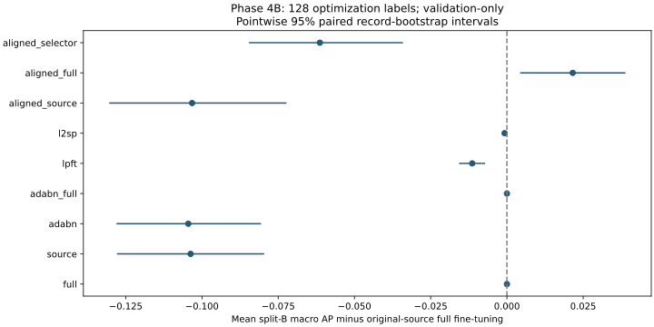
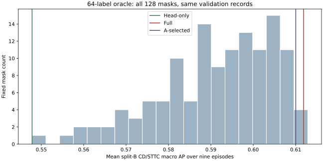
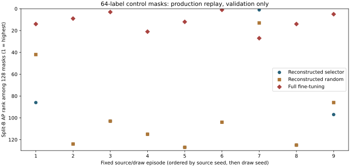

# Phase 4B — validation-only adaptation results

[Protocol](PHASE4B_PROTOCOL.md) · [Full numeric results](PHASE4B_AGGREGATES.json)

**Any new method beats full at 128 labels under the requested pointwise rule: True.** Winners: aligned_full.

The rule is a paired-bootstrap 95% lower bound above zero. Pointwise findings are not automatically familywise-confirmed: seven-method Bonferroni intervals are in the aggregate JSON. B was already examined in Phase 4A; this is exploratory validation reuse, not a fresh held-out test or clinical validation. All comparisons share the same 500 B records and nine fixed source/draw episodes. A=500 is used for selection; optimization label budgets exclude these extra labels.

## Scientific verdict

The selected MK-MMD source pretraining plus full fine-tuning meets the requested primary pointwise rule at 128 labels: macro AP **0.666673** versus **0.645089**, difference **+0.021584**, 95% CI **[+0.004333, +0.038866]**. Macro AUROC is **0.840658** versus **0.833343**. It is the only method meeting that primary AP rule. The seven-method Bonferroni sensitivity interval is **[-0.002344, +0.046415]**, which includes zero: this is a pointwise exploratory finding, not familywise-confirmed superiority or a held-out-test result.

At 64 labels the global A-selected mask does **not** establish a freezing improvement. The per-episode A-selected oracle also remains uncertain: difference **+0.003796**, 95% CI **[-0.002699, +0.009350]**. One nonfull fixed mask, `1101111`, has a higher descriptive B mean than full (+0.000984), but it was identified from B and is not an independently validated winner. Thus neither “freezing always hurts” nor “no useful mask can ever exist” follows from these results.

The evidence favors investigating alignment followed by full adaptation, rather than crediting the selective-freezing policy: the aligned selector remains below original-source full fine-tuning at 128 labels. The alignment arm includes additional U exposure and both-domain BN updates, so these results do not isolate a causal MK-MMD effect. No further CPSC test analysis or new experiment is authorized or performed in this task.

### Primary winner: separate CD/STTC uncertainty

| Metric | Difference versus original-source full [pointwise 95% CI] |
|---|---|
| CD AP | +0.011859 [-0.008840, +0.032996] |
| STTC AP | +0.031309 [+0.003382, +0.060030] |
| Macro AUROC | +0.007316 [-0.001327, +0.016053] |

The CD AP and macro AUROC intervals include zero. The larger STTC AP increment contributes most of the macro AP difference; its separate-label interval is exploratory and not an additional multiplicity-controlled discovery.

## Main method × budget table

Zero-update arms have three distinct source vectors reused across nine paired cells and nominal budgets; their target gradient fits consume zero labels. However, the aligned source is selected using source fold9 and 128-label full adaptations evaluated on A, so its model-selection procedure is not label-free. That same lambda also conditions the 64- and 256-label aligned arms. AP/AUROC are per-model values averaged over cells, not scores pooled or ensembled. CD/STTC are annotation-union proxies, not adjudicated disease diagnoses.

| Budget | Method | Fit labels | Macro AP | Macro AUROC | AP difference [95% CI] | CD AP / AUROC | STTC AP / AUROC |
|---:|---|---:|---:|---:|---|---|---|
| 64 | full | 64 | 0.611862 | 0.811841 | +0.000000 [+0.000000, +0.000000] | 0.742729 / 0.871244 | 0.480994 / 0.752437 |
| 64 | source | 0 | 0.541379 | 0.769197 | -0.070483 [-0.089386, -0.051924] | 0.712039 / 0.872763 | 0.370718 / 0.665632 |
| 64 | adabn | 0 | 0.540608 | 0.765928 | -0.071253 [-0.090083, -0.052370] | 0.710385 / 0.868189 | 0.370832 / 0.663666 |
| 64 | adabn_full | 64 | 0.611862 | 0.811841 | +0.000000 [+0.000000, +0.000000] | 0.742729 / 0.871244 | 0.480994 / 0.752437 |
| 64 | lpft | 64 | 0.610959 | 0.813238 | -0.000903 [-0.004236, +0.002636] | 0.745857 / 0.875658 | 0.476061 / 0.750818 |
| 64 | l2sp | 64 | 0.610953 | 0.811525 | -0.000908 [-0.001662, -0.000176] | 0.742136 / 0.871260 | 0.479770 / 0.751790 |
| 64 | aligned_source | 0 | 0.541858 | 0.783152 | -0.070004 [-0.093867, -0.042715] | 0.689198 / 0.878660 | 0.394518 / 0.687644 |
| 64 | aligned_full | 64 | 0.625525 | 0.824845 | +0.013664 [-0.002458, +0.030977] | 0.738559 / 0.882096 | 0.512491 / 0.767595 |
| 64 | aligned_selector | 64 | 0.570290 | 0.804469 | -0.041571 [-0.063420, -0.015491] | 0.691271 / 0.875552 | 0.449309 / 0.733385 |
| 128 | full | 128 | 0.645089 | 0.833343 | +0.000000 [+0.000000, +0.000000] | 0.777066 / 0.892987 | 0.513113 / 0.773699 |
| 128 | source | 0 | 0.541379 | 0.769197 | -0.103711 [-0.127883, -0.079609] | 0.712039 / 0.872763 | 0.370718 / 0.665632 |
| 128 | adabn | 0 | 0.540608 | 0.765928 | -0.104481 [-0.128030, -0.080632] | 0.710385 / 0.868189 | 0.370832 / 0.663666 |
| 128 | adabn_full | 128 | 0.645089 | 0.833343 | +0.000000 [+0.000000, +0.000000] | 0.777066 / 0.892987 | 0.513113 / 0.773699 |
| 128 | lpft | 128 | 0.633702 | 0.828640 | -0.011387 [-0.015701, -0.007158] | 0.770047 / 0.891373 | 0.497358 / 0.765908 |
| 128 | l2sp | 128 | 0.644329 | 0.832946 | -0.000760 [-0.001185, -0.000328] | 0.776643 / 0.892811 | 0.512015 / 0.773081 |
| 128 | aligned_source | 0 | 0.541858 | 0.783152 | -0.103231 [-0.130409, -0.072294] | 0.689198 / 0.878660 | 0.394518 / 0.687644 |
| 128 | aligned_full | 128 | 0.666673 | 0.840658 | +0.021584 [+0.004333, +0.038866] | 0.788925 / 0.896589 | 0.544422 / 0.784727 |
| 128 | aligned_selector | 128 | 0.583758 | 0.814628 | -0.061332 [-0.084583, -0.034108] | 0.692872 / 0.877037 | 0.474643 / 0.752218 |
| 256 | full | 256 | 0.666968 | 0.842992 | +0.000000 [+0.000000, +0.000000] | 0.810114 / 0.907680 | 0.523821 / 0.778303 |
| 256 | source | 0 | 0.541379 | 0.769197 | -0.125589 [-0.154268, -0.096778] | 0.712039 / 0.872763 | 0.370718 / 0.665632 |
| 256 | adabn | 0 | 0.540608 | 0.765928 | -0.126359 [-0.154912, -0.097499] | 0.710385 / 0.868189 | 0.370832 / 0.663666 |
| 256 | adabn_full | 256 | 0.666968 | 0.842992 | +0.000000 [+0.000000, +0.000000] | 0.810114 / 0.907680 | 0.523821 / 0.778303 |
| 256 | lpft | 256 | 0.650197 | 0.835656 | -0.016771 [-0.021186, -0.012061] | 0.796622 / 0.903112 | 0.503771 / 0.768199 |
| 256 | l2sp | 256 | 0.665871 | 0.842463 | -0.001096 [-0.001561, -0.000669] | 0.809346 / 0.907395 | 0.522397 / 0.777530 |
| 256 | aligned_source | 0 | 0.541858 | 0.783152 | -0.125110 [-0.156392, -0.090078] | 0.689198 / 0.878660 | 0.394518 / 0.687644 |
| 256 | aligned_full | 256 | 0.686199 | 0.846887 | +0.019232 [+0.002732, +0.035138] | 0.823235 / 0.908767 | 0.549163 / 0.785007 |
| 256 | aligned_selector | 256 | 0.634027 | 0.834322 | -0.032941 [-0.054462, -0.008503] | 0.737326 / 0.893299 | 0.530727 / 0.775346 |

## A-only hyperparameter choices

L2-SP chooses the highest mean A macro AP over the nine episodes, with smaller alpha breaking exact ties.

| Budget | A AP: alpha=1e-4 | A AP: alpha=1e-3 | A AP: alpha=1e-2 | Selected alpha |
|---:|---:|---:|---:|---:|
| 64 | 0.594367 | 0.590462 | 0.580643 | 0.0001 |
| 128 | 0.638365 | 0.633586 | 0.615238 | 0.0001 |
| 256 | 0.668358 | 0.662857 | 0.636116 | 0.0001 |

Original mean fold9 macro AUROC: **0.902868**. The prespecified screen requires mean AUROC ≥0.852868 and both label AUROCs >0.5 for every seed. This .05 tolerance is an engineering screen, not a clinical margin.

| Lambda | Mean fold9 macro AUROC | A macro AP after B128 full adaptation | Source screen | Selected |
|---:|---:|---:|---|---|
| 0.1 | 0.905576 | 0.651544 | PASS | Yes |
| 1.0 | 0.788438 | 0.582141 | FAIL | No |

Lambda=0.1 preserves source fold9 discrimination (mean AUROC 0.905576 versus original 0.902868); lambda=1.0 degrades it to 0.788438 and fails the screen. Among qualified candidates, A AP determines selection. No B labels or scores entered alpha/lambda selection.

## Low-label oracle

A-selected 64-label mask: `1001111`; B AP difference versus full **-0.001837**, 95% CI **[-0.010807, +0.007404]**. Freezing wins under the lower-bound-above-zero criterion: **False**.

Full ranks A/B: 13/2; head-only ranks A/B: 128/128. A-selected full would give a degenerate identity interval, not an equivalence test. Neither an interval including zero nor this finite grid proves that useful freezing is universally impossible.

| A rank | Mask | A AP | B AP | B rank |
|---:|---|---:|---:|---:|
| 1 | `1001111` | 0.602086 | 0.610025 | 4 |
| 2 | `1001110` | 0.600096 | 0.605913 | 19 |
| 3 | `1011111` | 0.599946 | 0.611664 | 3 |
| 4 | `1001101` | 0.599148 | 0.606965 | 15 |
| 5 | `1011101` | 0.599086 | 0.608768 | 7 |

Bit order: view_1..view_5, fusion_1, fusion_2; 1 adapts. The per-episode A oracle and CD/STTC contrasts are in the aggregate JSON. Original recorded B64 selector masks were not included in the adaptation bundle; no B128 mask is mislabeled as B64.

### Module effects at 64 labels

B macro AP regressed on the seven bits plus episode fixed effects. Intervals use joint record resamples, not independent regression rows; exploratory and not multiplicity-adjusted.

| Module | Adapt minus freeze | 95% CI |
|---|---:|---|
| view_1 | +0.008243 | [+0.004204, +0.012466] |
| view_2 | +0.006883 | [-0.000439, +0.013955] |
| view_3 | +0.004922 | [-0.000455, +0.010251] |
| view_4 | +0.017219 | [+0.010414, +0.023729] |
| view_5 | +0.012782 | [+0.005548, +0.020539] |
| fusion_1 | +0.008148 | [+0.006275, +0.010291] |
| fusion_2 | +0.004946 | [+0.003231, +0.006643] |

## Source fold-9 performance and alignment

| Seed | Lambda | Original CD/STTC AUROC | Aligned CD/STTC AUROC | Selected epoch |
|---:|---:|---|---|---:|
| 15101 | 0.1 | 0.934554 / 0.876459 | 0.935161 / 0.881025 | 19 |
| 15102 | 0.1 | 0.932926 / 0.877698 | 0.928959 / 0.879846 | 20 |
| 15103 | 0.1 | 0.924275 / 0.871296 | 0.936229 / 0.872238 | 13 |
| 15101 | 1.0 | 0.934554 / 0.876459 | 0.878795 / 0.605428 | 2 |
| 15102 | 1.0 | 0.932926 / 0.877698 | 0.903530 / 0.855803 | 21 |
| 15103 | 1.0 | 0.924275 / 0.871296 | 0.884838 / 0.602232 | 10 |

Six lambda/seed candidates were trained from fresh initialization; one selected lambda supplies three aligned models. Source normalization, eligibility, 50-epoch OneCycle schedule and fold9 AP checkpoint selection match the original recipe. Source batches are 128, unlabelled target batches 32. Alignment uses source labels only; U contains 2,859 adaptation signals and excludes both A and B. Target passes also update source BN statistics, so improvement cannot be attributed uniquely to MMD without an additional matched ablation. The selected-source selector uses the original production MMD/geometry logic on source anchors and G, not a mask reused from another source.

## Reproducibility, runtime and isolation

See [the validation report](PHASE4B_VALIDATION_REPORT.md) for actual replay checks, fit/checkpoint counts, runtimes and preservation. All per-record arrays and the six permitted aligned-source checkpoints remain gitignored. No target or AdaBN checkpoint was saved. Test exclusion guards and OS-open audit guards remain active. PTB-XL fold 10 and CPSC test-half signals/labels/predictions/metrics/seals were never read. The only CPSC inputs are the isolated adaptation bundle; source inputs were verified folds1–9. No commits, pushes or merges.

## Reconstructed original-source controls at 64 labels

All nine B128 production selector/random pairs reproduced the retained bundle masks exactly. The same unchanged source/G pipeline then reconstructed B64 masks; no independently retained original B64 receipts were available. These controls are not B128 masks relabeled as B64. No A/B outcomes selected these masks; the following ranks are secondary descriptive B evaluation after primary fitting and A-only selection finished.

Ranks are within each episode's 128 masks, not ranks of independent test cohorts. Each control may choose a different mask in each episode. Coincident selector/random markers reflect identical ranks; the table gives every exact mask and rank.

| Source | Draw | Selector mask | A / B rank | Random mask | A / B rank | Full B rank | Head B rank |
|---:|---:|---|---|---|---|---:|---:|
| 15101 | 16101 | `0001111` | 28 / 86 | `0010111` | 35 / 42 | 14 | 124 |
| 15101 | 16102 | `0000000` | 124 / 124 | `0000000` | 124 / 124 | 9 | 124 |
| 15101 | 16103 | `0000100` | 103 / 103 | `0000100` | 103 / 103 | 3 | 128 |
| 15102 | 16101 | `0000011` | 120 / 115 | `0000011` | 120 / 115 | 21 | 128 |
| 15102 | 16102 | `0000000` | 128 / 127 | `0000000` | 128 / 127 | 12 | 127 |
| 15102 | 16103 | `0000111` | 111 / 104 | `0000111` | 111 / 104 | 1 | 128 |
| 15103 | 16101 | `0011111` | 1 / 1 | `0110111` | 2 / 13 | 27 | 125 |
| 15103 | 16102 | `0000000` | 124 / 125 | `0000000` | 124 / 125 | 14 | 125 |
| 15103 | 16103 | `0010110` | 107 / 97 | `0100110` | 79 / 86 | 5 | 128 |

| Reconstructed policy | B macro AP | Difference versus full [pointwise 95% CI] |
|---|---:|---|
| selector | 0.573620 | -0.038242 [-0.051142, -0.024981] |
| random | 0.573844 | -0.038018 [-0.050447, -0.025346] |

### CD/STTC detail for the A-ranked oracle masks

| Mask | A CD AP | B CD AP | A STTC AP | B STTC AP |
|---|---:|---:|---:|---:|
| `1001111` | 0.745450 | 0.738991 | 0.458722 | 0.481058 |
| `1001110` | 0.745680 | 0.737316 | 0.454513 | 0.474510 |
| `1011111` | 0.742678 | 0.741640 | 0.457213 | 0.481687 |
| `1001101` | 0.743906 | 0.737081 | 0.454391 | 0.476849 |
| `1011101` | 0.742695 | 0.740200 | 0.455476 | 0.477337 |

Primary A-selected mask, separate-label differences versus full:

| Label | AP difference [95% CI] |
|---|---|
| CD | -0.003739 [-0.017631, +0.010351] |
| STTC | +0.000065 [-0.011007, +0.011655] |

## AdaBN + full sanity check

All 27 paired AdaBN+full versus ordinary-full fits had identical 200-update training loss histories and module parameter-drift norms. A/B probabilities were bitwise-identical in 10/27 pairs; the remaining pairs need not have identical BN buffer states. AP and AUROC, which depend on score ordering, coincide in the reported comparisons, including the paired AP intervals. These were separate recorded fits, not a substituted comparator. [Aggregate check](PHASE4B_ADABN_SANITY.json).
