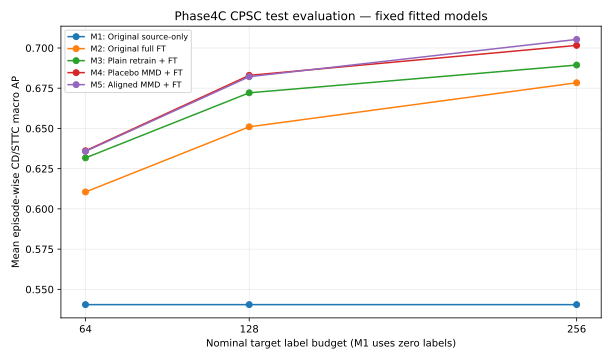

# Phase4C — committed confirmatory evaluation

Protocol commit: **2e3d0c740bbb38aa071d5dfd92daac7f6885e562**. Protocol SHA-256: 8426d9a541aef5a1fd159d0481a930af828db1f62d667611282f904330d7f118.

This was the single pre-registered **Phase4C** test evaluation. The same locked cohort had been evaluated previously in Experiment4; this is not globally untouched external validation. No test-based tuning or analysis changes occurred. No source was retrained and no hyperparameters were tuned. The108 fixed200-update target fits were regenerated solely for deterministic state authentication, as authorized by the committed protocol; this is not a claim that no optimization was performed.

Replay matches: **108/108 fits**, both A and B bitwise; corresponding state/history/recipe bindings match. Source checkpoints were existing and hash-verified. No target checkpoints were written.

All135 logical predictions /111 physical vectors were frozen before labels. Prediction manifest: private/phase4c_confirm_run/PREDICTION_MANIFEST.json. SHA-256: **6e5833a69983371a279163b843a79f8be77a825681a06c6083c3819032964ab2**. Manifest UTC timestamp: 2026-11-23T13:30:53.863596+00:00.

Records: **3860**. Labels are recorded-code CD/STTC annotation-union proxies, not adjudicated diagnoses. V2 validity gate: PASS. Observed/unknown and class denominators are given below. Unknowns were not converted to negatives.

## Confirmatory sequence — macro AP at128 labels

| Order | Contrast | Difference | Paired95% CI | Valid draws | Confirmatory eligibility | Verdict |
|---|---|---:|---|---:|---|---|
| primary | M5 minus M3 | 0.010005 | [+0.002771, +0.017426] | 10000 | True | **success** |
| S1 | M4 minus M3 | 0.010848 | [+0.004484, +0.017472] | 10000 | True | **success** |
| S2 | M5 minus M4 | -0.000843 | [-0.006432, +0.004959] | 10000 | True | **not successful** |

The combined aligned-pretraining recipe improved macro AP over the matched plain-retrain pipeline under the registered primary rule. The placebo-MMD contrast also succeeded. Additional target alignment beyond placebo MMD was not established by S2; this does not establish equivalence or absence of an alignment effect.

Success requires lower95% CI bound >0 and at least9500 supported draws. S1 requires primary success; S2 requires both primary and S1 success. A closed gate makes later evidence descriptive only even if its interval excludes zero. No Holm family or alternative test was used. Failure to establish benefit is not proof of equivalence or no effect.

## Main table

Equal means of nine episode-wise metrics, not probability ensembles or nine independent cohorts. All64/256 results, AUROC and per-label results are descriptive. M1 aliases three source models across draws/budgets and uses zero target labels.

| Method | Budget | Macro AP | Macro AUROC | CD AP | CD AUROC | STTC AP | STTC AUROC |
|---|---:|---:|---:|---:|---:|---:|---:|
| M1: Original source-only | 64 | 0.540515 | 0.782031 | 0.747807 | 0.891733 | 0.333222 | 0.672330 |
| M1: Original source-only | 128 | 0.540515 | 0.782031 | 0.747807 | 0.891733 | 0.333222 | 0.672330 |
| M1: Original source-only | 256 | 0.540515 | 0.782031 | 0.747807 | 0.891733 | 0.333222 | 0.672330 |
| M2: Original full FT | 64 | 0.610527 | 0.822123 | 0.776584 | 0.891218 | 0.444470 | 0.753029 |
| M2: Original full FT | 128 | 0.651007 | 0.844174 | 0.825275 | 0.916491 | 0.476739 | 0.771857 |
| M2: Original full FT | 256 | 0.678397 | 0.854766 | 0.853418 | 0.927950 | 0.503376 | 0.781583 |
| M3: Plain retrain + FT | 64 | 0.631712 | 0.830175 | 0.803734 | 0.904430 | 0.459689 | 0.755920 |
| M3: Plain retrain + FT | 128 | 0.672152 | 0.851451 | 0.845309 | 0.926128 | 0.498996 | 0.776775 |
| M3: Plain retrain + FT | 256 | 0.689389 | 0.859060 | 0.867841 | 0.936672 | 0.510937 | 0.781449 |
| M4: Placebo MMD + FT | 64 | 0.636107 | 0.833107 | 0.781304 | 0.897345 | 0.490909 | 0.768869 |
| M4: Placebo MMD + FT | 128 | 0.683000 | 0.853495 | 0.836161 | 0.922352 | 0.529840 | 0.784637 |
| M4: Placebo MMD + FT | 256 | 0.701614 | 0.861770 | 0.858899 | 0.932631 | 0.544329 | 0.790909 |
| M5: Aligned MMD + FT | 64 | 0.635753 | 0.838041 | 0.782852 | 0.903038 | 0.488655 | 0.773043 |
| M5: Aligned MMD + FT | 128 | 0.682157 | 0.857633 | 0.839257 | 0.927273 | 0.525058 | 0.787993 |
| M5: Aligned MMD + FT | 256 | 0.705317 | 0.865635 | 0.865543 | 0.937580 | 0.545092 | 0.793691 |

Figure: mean fitted-episode macro AP at the three fixed label budgets; lines aid reading, not interpolation to untested budgets. No interval shading or invented uncertainty. M1 has zero adaptation labels regardless of nominal budget.

## Descriptive threshold metrics at128 labels

Threshold0.5, units0–1; strict label/episode means. N/A is mathematically undefined, never measured zero.

| Method | Accuracy | Precision | Recall | Specificity | F1 | Balanced accuracy | NPV |
|---|---:|---:|---:|---:|---:|---:|---:|
| M1 | 0.767573 | 0.513108 | 0.494594 | 0.857997 | 0.498501 | 0.676295 | 0.838893 |
| M2 | 0.813788 | 0.642770 | 0.575219 | 0.893671 | 0.596404 | 0.734445 | 0.864518 |
| M3 | 0.820725 | 0.652795 | 0.598121 | 0.895037 | 0.613479 | 0.746579 | 0.871648 |
| M4 | 0.821920 | 0.670947 | 0.576698 | 0.903906 | 0.606919 | 0.740302 | 0.866672 |
| M5 | 0.827087 | 0.674222 | 0.603493 | 0.901783 | 0.624434 | 0.752638 | 0.873862 |

### Per-label threshold metrics at128

| Method | Label | Accuracy | Precision | Recall | Specificity | F1 | Balanced accuracy | NPV |
|---|---|---:|---:|---:|---:|---:|---:|---:|
| M1 | CD | 0.837565 | 0.686146 | 0.723087 | 0.879120 | 0.703154 | 0.801103 | 0.897647 |
| M1 | STTC | 0.697582 | 0.340069 | 0.266100 | 0.836875 | 0.293848 | 0.551488 | 0.780139 |
| M2 | CD | 0.867012 | 0.768124 | 0.724276 | 0.918825 | 0.742658 | 0.821550 | 0.902522 |
| M2 | STTC | 0.760564 | 0.517415 | 0.426162 | 0.868517 | 0.450149 | 0.647340 | 0.826514 |
| M3 | CD | 0.872942 | 0.770293 | 0.750973 | 0.917216 | 0.757241 | 0.834094 | 0.911291 |
| M3 | STTC | 0.768509 | 0.535298 | 0.445270 | 0.872858 | 0.469716 | 0.659064 | 0.832006 |
| M4 | CD | 0.867300 | 0.768389 | 0.726762 | 0.918315 | 0.743075 | 0.822538 | 0.903611 |
| M4 | STTC | 0.776540 | 0.573506 | 0.426634 | 0.889498 | 0.470763 | 0.658066 | 0.829733 |
| M5 | CD | 0.876079 | 0.779343 | 0.750865 | 0.921532 | 0.762130 | 0.836198 | 0.911396 |
| M5 | STTC | 0.778094 | 0.569101 | 0.456122 | 0.882035 | 0.486739 | 0.669078 | 0.836328 |

## Descriptive paired contrasts

Pointwise CIs conditional on fixed models. Only the eligible128-label macro-AP sequence above is confirmatory; every other entry below is descriptive.

| Contrast / budget | Macro AP difference [95% CI] | Macro AUROC difference [95% CI] |
|---|---|---|
| M5-minus-M3/B64 | 0.004042 [-0.003343, +0.011764] | 0.007865 [+0.004723, +0.011031] |
| M4-minus-M3/B64 | 0.004395 [-0.002923, +0.011944] | 0.002932 [-0.000358, +0.006335] |
| M5-minus-M4/B64 | -0.000353 [-0.005807, +0.005139] | 0.004933 [+0.002530, +0.007291] |
| M3-minus-M2/B64 | 0.021184 [+0.014935, +0.027092] | 0.008052 [+0.005013, +0.011116] |
| M5-minus-M3/B128 | 0.010005 [+0.002771, +0.017426] | 0.006182 [+0.003297, +0.009135] |
| M4-minus-M3/B128 | 0.010848 [+0.004484, +0.017472] | 0.002043 [-0.000908, +0.005020] |
| M5-minus-M4/B128 | -0.000843 [-0.006432, +0.004959] | 0.004138 [+0.001905, +0.006324] |
| M3-minus-M2/B128 | 0.021145 [+0.015291, +0.026887] | 0.007277 [+0.004576, +0.010001] |
| M5-minus-M3/B256 | 0.015928 [+0.009310, +0.022531] | 0.006575 [+0.003830, +0.009301] |
| M4-minus-M3/B256 | 0.012225 [+0.006009, +0.018385] | 0.002709 [-0.000177, +0.005572] |
| M5-minus-M4/B256 | 0.003703 [-0.001170, +0.008818] | 0.003865 [+0.001829, +0.005813] |
| M3-minus-M2/B256 | 0.010992 [+0.005742, +0.016406] | 0.004294 [+0.001665, +0.006942] |

All intervals use10000 shared Experiment4 canonical-record/known-group resamples, seed78701, tie-aware weighted rankings and no redrawing. Unsupported draw counts are retained in the private analysis. Intervals omit training/selection uncertainty and unknown patient linkage. S2's domain substitution includes BN effects and does not isolate the MMD gradient alone.

## Outcome denominators

| Label | Observed | Unknown | Positive proxy | Negative proxy |
|---|---:|---:|---:|---:|
| CD | 3860 | 0 | 1028 | 2832 |
| STTC | 3860 | 0 | 942 | 2918 |

## Per-fitted-vector integer confusion counts

Source/draw numbers are experimental RNG seeds, not participant IDs. M1 vectors are explicitly aliased across nominal budgets/draws. Counts below describe individual fitted vectors, not mean fractional confusion matrices.

| Predictor | Label | TP | TN | FP | FN |
|---|---|---:|---:|---:|---:|
| M1/s15101 | CD | 783 | 2474 | 358 | 245 |
| M1/s15101 | STTC | 189 | 2522 | 396 | 753 |
| M1/s15102 | CD | 696 | 2554 | 278 | 332 |
| M1/s15102 | STTC | 364 | 2289 | 629 | 578 |
| M1/s15103 | CD | 751 | 2441 | 391 | 277 |
| M1/s15103 | STTC | 199 | 2515 | 403 | 743 |
| M2/B64/s15101/d16101 | CD | 669 | 2628 | 204 | 359 |
| M2/B64/s15101/d16101 | STTC | 584 | 2174 | 744 | 358 |
| M2/B64/s15101/d16102 | CD | 846 | 2460 | 372 | 182 |
| M2/B64/s15101/d16102 | STTC | 499 | 2467 | 451 | 443 |
| M2/B64/s15101/d16103 | CD | 743 | 2600 | 232 | 285 |
| M2/B64/s15101/d16103 | STTC | 385 | 2500 | 418 | 557 |
| M2/B64/s15102/d16101 | CD | 659 | 2683 | 149 | 369 |
| M2/B64/s15102/d16101 | STTC | 621 | 2178 | 740 | 321 |
| M2/B64/s15102/d16102 | CD | 809 | 2480 | 352 | 219 |
| M2/B64/s15102/d16102 | STTC | 406 | 2498 | 420 | 536 |
| M2/B64/s15102/d16103 | CD | 691 | 2621 | 211 | 337 |
| M2/B64/s15102/d16103 | STTC | 382 | 2529 | 389 | 560 |
| M2/B64/s15103/d16101 | CD | 676 | 2612 | 220 | 352 |
| M2/B64/s15103/d16101 | STTC | 568 | 2215 | 703 | 374 |
| M2/B64/s15103/d16102 | CD | 797 | 2453 | 379 | 231 |
| M2/B64/s15103/d16102 | STTC | 282 | 2603 | 315 | 660 |
| M2/B64/s15103/d16103 | CD | 752 | 2549 | 283 | 276 |
| M2/B64/s15103/d16103 | STTC | 295 | 2521 | 397 | 647 |
| M2/B128/s15101/d16101 | CD | 665 | 2672 | 160 | 363 |
| M2/B128/s15101/d16101 | STTC | 526 | 2402 | 516 | 416 |
| M2/B128/s15101/d16102 | CD | 847 | 2518 | 314 | 181 |
| M2/B128/s15101/d16102 | STTC | 294 | 2711 | 207 | 648 |
| M2/B128/s15101/d16103 | CD | 735 | 2604 | 228 | 293 |
| M2/B128/s15101/d16103 | STTC | 494 | 2422 | 496 | 448 |
| M2/B128/s15102/d16101 | CD | 692 | 2685 | 147 | 336 |
| M2/B128/s15102/d16101 | STTC | 515 | 2471 | 447 | 427 |
| M2/B128/s15102/d16102 | CD | 826 | 2530 | 302 | 202 |
| M2/B128/s15102/d16102 | STTC | 270 | 2732 | 186 | 672 |
| M2/B128/s15102/d16103 | CD | 707 | 2649 | 183 | 321 |
| M2/B128/s15102/d16103 | STTC | 530 | 2402 | 516 | 412 |
| M2/B128/s15103/d16101 | CD | 685 | 2644 | 188 | 343 |
| M2/B128/s15103/d16101 | STTC | 478 | 2392 | 526 | 464 |
| M2/B128/s15103/d16102 | CD | 808 | 2530 | 302 | 220 |
| M2/B128/s15103/d16102 | STTC | 135 | 2774 | 144 | 807 |
| M2/B128/s15103/d16103 | CD | 736 | 2587 | 245 | 292 |
| M2/B128/s15103/d16103 | STTC | 371 | 2503 | 415 | 571 |
| M2/B256/s15101/d16101 | CD | 723 | 2659 | 173 | 305 |
| M2/B256/s15101/d16101 | STTC | 527 | 2524 | 394 | 415 |
| M2/B256/s15101/d16102 | CD | 772 | 2632 | 200 | 256 |
| M2/B256/s15101/d16102 | STTC | 434 | 2624 | 294 | 508 |
| M2/B256/s15101/d16103 | CD | 745 | 2649 | 183 | 283 |
| M2/B256/s15101/d16103 | STTC | 520 | 2411 | 507 | 422 |
| M2/B256/s15102/d16101 | CD | 748 | 2663 | 169 | 280 |
| M2/B256/s15102/d16101 | STTC | 491 | 2532 | 386 | 451 |
| M2/B256/s15102/d16102 | CD | 790 | 2623 | 209 | 238 |
| M2/B256/s15102/d16102 | STTC | 429 | 2600 | 318 | 513 |
| M2/B256/s15102/d16103 | CD | 722 | 2656 | 176 | 306 |
| M2/B256/s15102/d16103 | STTC | 461 | 2525 | 393 | 481 |
| M2/B256/s15103/d16101 | CD | 731 | 2631 | 201 | 297 |
| M2/B256/s15103/d16101 | STTC | 474 | 2487 | 431 | 468 |
| M2/B256/s15103/d16102 | CD | 745 | 2645 | 187 | 283 |
| M2/B256/s15103/d16102 | STTC | 341 | 2603 | 315 | 601 |
| M2/B256/s15103/d16103 | CD | 715 | 2615 | 217 | 313 |
| M2/B256/s15103/d16103 | STTC | 359 | 2526 | 392 | 583 |
| M3/B64/s15101/d16101 | CD | 679 | 2612 | 220 | 349 |
| M3/B64/s15101/d16101 | STTC | 593 | 2233 | 685 | 349 |
| M3/B64/s15101/d16102 | CD | 819 | 2531 | 301 | 209 |
| M3/B64/s15101/d16102 | STTC | 471 | 2499 | 419 | 471 |
| M3/B64/s15101/d16103 | CD | 729 | 2613 | 219 | 299 |
| M3/B64/s15101/d16103 | STTC | 399 | 2549 | 369 | 543 |
| M3/B64/s15102/d16101 | CD | 702 | 2631 | 201 | 326 |
| M3/B64/s15102/d16101 | STTC | 599 | 2181 | 737 | 343 |
| M3/B64/s15102/d16102 | CD | 895 | 2373 | 459 | 133 |
| M3/B64/s15102/d16102 | STTC | 421 | 2541 | 377 | 521 |
| M3/B64/s15102/d16103 | CD | 798 | 2628 | 204 | 230 |
| M3/B64/s15102/d16103 | STTC | 387 | 2510 | 408 | 555 |
| M3/B64/s15103/d16101 | CD | 656 | 2649 | 183 | 372 |
| M3/B64/s15103/d16101 | STTC | 586 | 2235 | 683 | 356 |
| M3/B64/s15103/d16102 | CD | 817 | 2462 | 370 | 211 |
| M3/B64/s15103/d16102 | STTC | 365 | 2534 | 384 | 577 |
| M3/B64/s15103/d16103 | CD | 680 | 2612 | 220 | 348 |
| M3/B64/s15103/d16103 | STTC | 289 | 2489 | 429 | 653 |
| M3/B128/s15101/d16101 | CD | 708 | 2630 | 202 | 320 |
| M3/B128/s15101/d16101 | STTC | 548 | 2425 | 493 | 394 |
| M3/B128/s15101/d16102 | CD | 840 | 2524 | 308 | 188 |
| M3/B128/s15101/d16102 | STTC | 359 | 2714 | 204 | 583 |
| M3/B128/s15101/d16103 | CD | 754 | 2595 | 237 | 274 |
| M3/B128/s15101/d16103 | STTC | 521 | 2488 | 430 | 421 |
| M3/B128/s15102/d16101 | CD | 813 | 2627 | 205 | 215 |
| M3/B128/s15102/d16101 | STTC | 543 | 2437 | 481 | 399 |
| M3/B128/s15102/d16102 | CD | 860 | 2513 | 319 | 168 |
| M3/B128/s15102/d16102 | STTC | 306 | 2713 | 205 | 636 |
| M3/B128/s15102/d16103 | CD | 823 | 2619 | 213 | 205 |
| M3/B128/s15102/d16103 | STTC | 509 | 2420 | 498 | 433 |
| M3/B128/s15103/d16101 | CD | 660 | 2673 | 159 | 368 |
| M3/B128/s15103/d16101 | STTC | 479 | 2450 | 468 | 463 |
| M3/B128/s15103/d16102 | CD | 842 | 2528 | 304 | 186 |
| M3/B128/s15103/d16102 | STTC | 121 | 2794 | 124 | 821 |
| M3/B128/s15103/d16103 | CD | 648 | 2669 | 163 | 380 |
| M3/B128/s15103/d16103 | STTC | 389 | 2482 | 436 | 553 |
| M3/B256/s15101/d16101 | CD | 755 | 2610 | 222 | 273 |
| M3/B256/s15101/d16101 | STTC | 495 | 2575 | 343 | 447 |
| M3/B256/s15101/d16102 | CD | 807 | 2590 | 242 | 221 |
| M3/B256/s15101/d16102 | STTC | 454 | 2603 | 315 | 488 |
| M3/B256/s15101/d16103 | CD | 778 | 2592 | 240 | 250 |
| M3/B256/s15101/d16103 | STTC | 529 | 2436 | 482 | 413 |
| M3/B256/s15102/d16101 | CD | 847 | 2634 | 198 | 181 |
| M3/B256/s15102/d16101 | STTC | 518 | 2495 | 423 | 424 |
| M3/B256/s15102/d16102 | CD | 867 | 2592 | 240 | 161 |
| M3/B256/s15102/d16102 | STTC | 441 | 2581 | 337 | 501 |
| M3/B256/s15102/d16103 | CD | 813 | 2660 | 172 | 215 |
| M3/B256/s15102/d16103 | STTC | 501 | 2409 | 509 | 441 |
| M3/B256/s15103/d16101 | CD | 698 | 2683 | 149 | 330 |
| M3/B256/s15103/d16101 | STTC | 404 | 2555 | 363 | 538 |
| M3/B256/s15103/d16102 | CD | 746 | 2644 | 188 | 282 |
| M3/B256/s15103/d16102 | STTC | 345 | 2624 | 294 | 597 |
| M3/B256/s15103/d16103 | CD | 713 | 2648 | 184 | 315 |
| M3/B256/s15103/d16103 | STTC | 399 | 2478 | 440 | 543 |
| M4/B64/s15101/d16101 | CD | 679 | 2619 | 213 | 349 |
| M4/B64/s15101/d16101 | STTC | 578 | 2216 | 702 | 364 |
| M4/B64/s15101/d16102 | CD | 856 | 2432 | 400 | 172 |
| M4/B64/s15101/d16102 | STTC | 391 | 2583 | 335 | 551 |
| M4/B64/s15101/d16103 | CD | 676 | 2688 | 144 | 352 |
| M4/B64/s15101/d16103 | STTC | 399 | 2465 | 453 | 543 |
| M4/B64/s15102/d16101 | CD | 677 | 2652 | 180 | 351 |
| M4/B64/s15102/d16101 | STTC | 574 | 2319 | 599 | 368 |
| M4/B64/s15102/d16102 | CD | 823 | 2495 | 337 | 205 |
| M4/B64/s15102/d16102 | STTC | 381 | 2534 | 384 | 561 |
| M4/B64/s15102/d16103 | CD | 685 | 2669 | 163 | 343 |
| M4/B64/s15102/d16103 | STTC | 378 | 2544 | 374 | 564 |
| M4/B64/s15103/d16101 | CD | 676 | 2609 | 223 | 352 |
| M4/B64/s15103/d16101 | STTC | 654 | 2341 | 577 | 288 |
| M4/B64/s15103/d16102 | CD | 856 | 2385 | 447 | 172 |
| M4/B64/s15103/d16102 | STTC | 448 | 2543 | 375 | 494 |
| M4/B64/s15103/d16103 | CD | 749 | 2610 | 222 | 279 |
| M4/B64/s15103/d16103 | STTC | 379 | 2566 | 352 | 563 |
| M4/B128/s15101/d16101 | CD | 653 | 2692 | 140 | 375 |
| M4/B128/s15101/d16101 | STTC | 462 | 2519 | 399 | 480 |
| M4/B128/s15101/d16102 | CD | 854 | 2507 | 325 | 174 |
| M4/B128/s15101/d16102 | STTC | 274 | 2748 | 170 | 668 |
| M4/B128/s15101/d16103 | CD | 666 | 2648 | 184 | 362 |
| M4/B128/s15101/d16103 | STTC | 459 | 2405 | 513 | 483 |
| M4/B128/s15102/d16101 | CD | 693 | 2670 | 162 | 335 |
| M4/B128/s15102/d16101 | STTC | 415 | 2632 | 286 | 527 |
| M4/B128/s15102/d16102 | CD | 835 | 2515 | 317 | 193 |
| M4/B128/s15102/d16102 | STTC | 190 | 2800 | 118 | 752 |
| M4/B128/s15102/d16103 | CD | 772 | 2602 | 230 | 256 |
| M4/B128/s15102/d16103 | STTC | 588 | 2307 | 611 | 354 |
| M4/B128/s15103/d16101 | CD | 670 | 2650 | 182 | 358 |
| M4/B128/s15103/d16101 | STTC | 511 | 2598 | 320 | 431 |
| M4/B128/s15103/d16102 | CD | 842 | 2522 | 310 | 186 |
| M4/B128/s15103/d16102 | STTC | 266 | 2777 | 141 | 676 |
| M4/B128/s15103/d16103 | CD | 739 | 2600 | 232 | 289 |
| M4/B128/s15103/d16103 | STTC | 452 | 2574 | 344 | 490 |
| M4/B256/s15101/d16101 | CD | 730 | 2632 | 200 | 298 |
| M4/B256/s15101/d16101 | STTC | 462 | 2584 | 334 | 480 |
| M4/B256/s15101/d16102 | CD | 798 | 2612 | 220 | 230 |
| M4/B256/s15101/d16102 | STTC | 421 | 2645 | 273 | 521 |
| M4/B256/s15101/d16103 | CD | 723 | 2600 | 232 | 305 |
| M4/B256/s15101/d16103 | STTC | 472 | 2464 | 454 | 470 |
| M4/B256/s15102/d16101 | CD | 771 | 2665 | 167 | 257 |
| M4/B256/s15102/d16101 | STTC | 496 | 2588 | 330 | 446 |
| M4/B256/s15102/d16102 | CD | 816 | 2615 | 217 | 212 |
| M4/B256/s15102/d16102 | STTC | 401 | 2637 | 281 | 541 |
| M4/B256/s15102/d16103 | CD | 785 | 2642 | 190 | 243 |
| M4/B256/s15102/d16103 | STTC | 480 | 2450 | 468 | 462 |
| M4/B256/s15103/d16101 | CD | 722 | 2641 | 191 | 306 |
| M4/B256/s15103/d16101 | STTC | 542 | 2601 | 317 | 400 |
| M4/B256/s15103/d16102 | CD | 811 | 2596 | 236 | 217 |
| M4/B256/s15103/d16102 | STTC | 523 | 2574 | 344 | 419 |
| M4/B256/s15103/d16103 | CD | 770 | 2589 | 243 | 258 |
| M4/B256/s15103/d16103 | STTC | 480 | 2513 | 405 | 462 |
| M5/B64/s15101/d16101 | CD | 649 | 2659 | 173 | 379 |
| M5/B64/s15101/d16101 | STTC | 617 | 2269 | 649 | 325 |
| M5/B64/s15101/d16102 | CD | 829 | 2485 | 347 | 199 |
| M5/B64/s15101/d16102 | STTC | 483 | 2514 | 404 | 459 |
| M5/B64/s15101/d16103 | CD | 772 | 2614 | 218 | 256 |
| M5/B64/s15101/d16103 | STTC | 442 | 2559 | 359 | 500 |
| M5/B64/s15102/d16101 | CD | 704 | 2632 | 200 | 324 |
| M5/B64/s15102/d16101 | STTC | 623 | 2176 | 742 | 319 |
| M5/B64/s15102/d16102 | CD | 856 | 2464 | 368 | 172 |
| M5/B64/s15102/d16102 | STTC | 381 | 2567 | 351 | 561 |
| M5/B64/s15102/d16103 | CD | 779 | 2612 | 220 | 249 |
| M5/B64/s15102/d16103 | STTC | 417 | 2491 | 427 | 525 |
| M5/B64/s15103/d16101 | CD | 664 | 2619 | 213 | 364 |
| M5/B64/s15103/d16101 | STTC | 633 | 2299 | 619 | 309 |
| M5/B64/s15103/d16102 | CD | 848 | 2460 | 372 | 180 |
| M5/B64/s15103/d16102 | STTC | 473 | 2492 | 426 | 469 |
| M5/B64/s15103/d16103 | CD | 742 | 2643 | 189 | 286 |
| M5/B64/s15103/d16103 | STTC | 420 | 2458 | 460 | 522 |
| M5/B128/s15101/d16101 | CD | 654 | 2698 | 134 | 374 |
| M5/B128/s15101/d16101 | STTC | 514 | 2510 | 408 | 428 |
| M5/B128/s15101/d16102 | CD | 821 | 2564 | 268 | 207 |
| M5/B128/s15101/d16102 | STTC | 307 | 2736 | 182 | 635 |
| M5/B128/s15101/d16103 | CD | 780 | 2588 | 244 | 248 |
| M5/B128/s15101/d16103 | STTC | 474 | 2496 | 422 | 468 |
| M5/B128/s15102/d16101 | CD | 783 | 2631 | 201 | 245 |
| M5/B128/s15102/d16101 | STTC | 442 | 2519 | 399 | 500 |
| M5/B128/s15102/d16102 | CD | 845 | 2572 | 260 | 183 |
| M5/B128/s15102/d16102 | STTC | 142 | 2817 | 101 | 800 |
| M5/B128/s15102/d16103 | CD | 808 | 2609 | 223 | 220 |
| M5/B128/s15102/d16103 | STTC | 578 | 2291 | 627 | 364 |
| M5/B128/s15103/d16101 | CD | 663 | 2672 | 160 | 365 |
| M5/B128/s15103/d16101 | STTC | 565 | 2543 | 375 | 377 |
| M5/B128/s15103/d16102 | CD | 842 | 2532 | 300 | 186 |
| M5/B128/s15103/d16102 | STTC | 336 | 2750 | 168 | 606 |
| M5/B128/s15103/d16103 | CD | 751 | 2622 | 210 | 277 |
| M5/B128/s15103/d16103 | STTC | 509 | 2502 | 416 | 433 |
| M5/B256/s15101/d16101 | CD | 752 | 2625 | 207 | 276 |
| M5/B256/s15101/d16101 | STTC | 472 | 2603 | 315 | 470 |
| M5/B256/s15101/d16102 | CD | 797 | 2642 | 190 | 231 |
| M5/B256/s15101/d16102 | STTC | 447 | 2643 | 275 | 495 |
| M5/B256/s15101/d16103 | CD | 767 | 2630 | 202 | 261 |
| M5/B256/s15101/d16103 | STTC | 520 | 2439 | 479 | 422 |
| M5/B256/s15102/d16101 | CD | 812 | 2638 | 194 | 216 |
| M5/B256/s15102/d16101 | STTC | 484 | 2551 | 367 | 458 |
| M5/B256/s15102/d16102 | CD | 822 | 2648 | 184 | 206 |
| M5/B256/s15102/d16102 | STTC | 342 | 2699 | 219 | 600 |
| M5/B256/s15102/d16103 | CD | 796 | 2642 | 190 | 232 |
| M5/B256/s15102/d16103 | STTC | 511 | 2390 | 528 | 431 |
| M5/B256/s15103/d16101 | CD | 741 | 2656 | 176 | 287 |
| M5/B256/s15103/d16101 | STTC | 587 | 2524 | 394 | 355 |
| M5/B256/s15103/d16102 | CD | 799 | 2631 | 201 | 229 |
| M5/B256/s15103/d16102 | STTC | 529 | 2529 | 389 | 413 |
| M5/B256/s15103/d16103 | CD | 782 | 2624 | 208 | 246 |
| M5/B256/s15103/d16103 | STTC | 569 | 2452 | 466 | 373 |

Raw signals, labels, IDs, predictions, group maps, fitted states and operational manifests/receipts remain private and gitignored. Only the requested aggregate report/figure were produced here; no commit, push or merge. Scientific conclusions are limited to annotation-proxy classification under the committed conditional evaluation design.

## Execution and final verification

- End-to-end runtime: **1,257.859 seconds (20 minutes 57.859 seconds)**, including preflight, 108 replay fits, signal processing, prediction generation, bootstrap analysis and reporting.
- Synthetic/regression verification before execution: **215 passed, 0 failed**. Two upstream WFDB/Pandas deprecation warnings were emitted. New execution code passes Ruff lint and formatting checks.
- Post-execution integrity check: **PASS**. The committed protocol and bound implementation files remain unchanged; all 111 saved predictor hashes and 135 logical aliases verify. The prediction-manifest timestamp precedes the single outcome-access marker.
- Outcome-access attempts: **1**. New target checkpoint files: **0**. Earlier results, source checkpoints, protocol history and consumed operations were preserved. Nothing was committed, pushed or merged.
