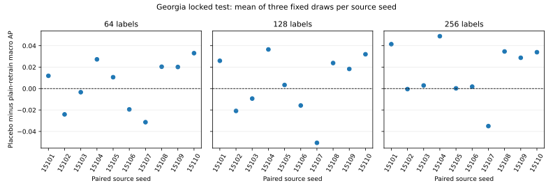

# Phase5 — single pre-registered Georgia test evaluation

Protocol commit: **aa1bf69ffe48fe1fa0655804156d2fcded98a5a4**. Protocol SHA256: `9f3a3e58b7850973f268f9884f4fe0444689dd292f5751891d613a30005971b4`. The committed protocol remained unchanged.

Prediction manifest: `private/phase5_georgia_confirm_run/PREDICTION_MANIFEST.json`. SHA256: **`ae83fd266844aa84e367f84b8793e895ac36031001ee33932816b1662f6821a5`**. UTC timestamp: 2026-11-24T01:29:44.502844+00:00. All270 logical cells /190 physical predictors were complete and sealed before the single outcome-access marker.

Replay authentication: **180/180** fits, A and B byte-for-byte plus final state,200-update history, source/normalization and recipe checks. Existing20 source checkpoints were hash-verified. No source was retrained, no settings were tuned and no target checkpoint was saved. The180 fixed target optimization replays reconstructed existing states only; this does not claim no optimization was performed.

## Primary — placebo minus plain full FT at128 labels

Mean macro-AP difference: **0.004347**. Paired hierarchical95% CI: **[-0.013911, +0.021064]**. Supported replicates: **10000/10000**; undefined: 0. Registered verdict: **not successful**.

Success requires lower95% bound strictly>0 and at least9500 supported draws. An interval crossing zero does not establish equivalence or no effect. This is the sole confirmatory endpoint; all other findings below are descriptive. The bootstrap resamples paired source seeds first, then one shared canonical-record/known-group sample across selected seeds, arms, draws, labels and budgets. It uses the frozen validation implementation and seed20261201, exact ties, strict means and no redrawing.

## Main table

Equal means of30 seed×draw episode metrics, not AP/AUROC of averaged probabilities or30 independent cohorts. Method(a) has10 physical zero-label source predictors aliased across nominal budgets/draws.

| Method | Budget | Macro AP | Macro AUROC | CD AP | CD AUROC | STTC AP | STTC AUROC |
|---|---:|---:|---:|---:|---:|---:|---:|
| (a) Plain source-only | 64 | 0.624258 | 0.813093 | 0.566348 | 0.868469 | 0.682168 | 0.757717 |
| (a) Plain source-only | 128 | 0.624258 | 0.813093 | 0.566348 | 0.868469 | 0.682168 | 0.757717 |
| (a) Plain source-only | 256 | 0.624258 | 0.813093 | 0.566348 | 0.868469 | 0.682168 | 0.757717 |
| (b) Plain retrain + full FT | 64 | 0.636445 | 0.823753 | 0.585159 | 0.877523 | 0.687731 | 0.769982 |
| (b) Plain retrain + full FT | 128 | 0.645918 | 0.830064 | 0.599580 | 0.886486 | 0.692256 | 0.773641 |
| (b) Plain retrain + full FT | 256 | 0.675755 | 0.843354 | 0.633546 | 0.893210 | 0.717965 | 0.793499 |
| (c) Placebo MMD + full FT | 64 | 0.640965 | 0.827612 | 0.579818 | 0.881755 | 0.702113 | 0.773470 |
| (c) Placebo MMD + full FT | 128 | 0.650265 | 0.835570 | 0.590029 | 0.890376 | 0.710500 | 0.780764 |
| (c) Placebo MMD + full FT | 256 | 0.691470 | 0.849134 | 0.647156 | 0.898276 | 0.735785 | 0.799992 |

## Descriptive paired contrasts

Only128-label macro AP above is confirmatory; all64/256 contrasts, AUROC and per-label results are descriptive pointwise intervals.

| Budget | Macro AP difference [95% CI] | Macro AUROC difference [95% CI] |
|---:|---|---|
| 64 | 0.004520 [-0.010454, +0.019101] | 0.003860 [-0.004921, +0.012006] |
| 128 | 0.004347 [-0.013911, +0.021064] | 0.005506 [-0.004431, +0.014180] |
| 256 | 0.015715 [-0.000928, +0.031203] | 0.005780 [-0.002763, +0.013218] |

### Per-label contrasts

| Budget | Label | AP difference [95% CI] | AUROC difference [95% CI] |
|---:|---|---|---|
| 64 | CD | -0.005342 [-0.018932, +0.008623] | 0.004232 [-0.003123, +0.011657] |
| 64 | STTC | 0.014382 [-0.005124, +0.033306] | 0.003487 [-0.007475, +0.013659] |
| 128 | CD | -0.009551 [-0.027955, +0.009123] | 0.003890 [-0.004272, +0.011858] |
| 128 | STTC | 0.018245 [-0.002915, +0.037971] | 0.007123 [-0.005463, +0.017959] |
| 256 | CD | 0.013610 [-0.005028, +0.033666] | 0.005066 [-0.001764, +0.012100] |
| 256 | STTC | 0.017820 [-0.002659, +0.036010] | 0.006494 [-0.005417, +0.016342] |

## Descriptive per-seed effects

Points are three-draw mean effects per seed. They are not per-seed confidence intervals. Every one of the ten predeclared seeds remains included.

| Budget | Seed | Macro AP difference | Macro AUROC difference | CD AP difference | STTC AP difference |
|---:|---:|---:|---:|---:|---:|
| 64 | 15101 | 0.011916 | 0.003611 | 0.004949 | 0.018882 |
| 64 | 15102 | -0.024082 | -0.009077 | -0.036747 | -0.011417 |
| 64 | 15103 | -0.003366 | -0.000668 | -0.007017 | 0.000284 |
| 64 | 15104 | 0.027281 | 0.014897 | 0.016757 | 0.037804 |
| 64 | 15105 | 0.010620 | 0.009834 | -0.011607 | 0.032847 |
| 64 | 15106 | -0.019427 | -0.007472 | -0.025440 | -0.013415 |
| 64 | 15107 | -0.031357 | -0.021216 | -0.023854 | -0.038860 |
| 64 | 15108 | 0.020408 | 0.016103 | 0.017315 | 0.023501 |
| 64 | 15109 | 0.020162 | 0.011074 | 0.006892 | 0.033432 |
| 64 | 15110 | 0.033048 | 0.021509 | 0.005333 | 0.060762 |
| 128 | 15101 | 0.025946 | 0.011741 | 0.019686 | 0.032207 |
| 128 | 15102 | -0.020851 | -0.004057 | -0.044906 | 0.003204 |
| 128 | 15103 | -0.009327 | -0.000061 | -0.016606 | -0.002049 |
| 128 | 15104 | 0.036521 | 0.017945 | 0.030980 | 0.042062 |
| 128 | 15105 | 0.003374 | 0.007214 | -0.018316 | 0.025063 |
| 128 | 15106 | -0.015768 | -0.003746 | -0.032411 | 0.000875 |
| 128 | 15107 | -0.050631 | -0.027250 | -0.050851 | -0.050412 |
| 128 | 15108 | 0.023848 | 0.019043 | 0.017066 | 0.030630 |
| 128 | 15109 | 0.018328 | 0.010490 | 0.005877 | 0.030779 |
| 128 | 15110 | 0.032028 | 0.023745 | -0.006031 | 0.070087 |
| 256 | 15101 | 0.041460 | 0.011676 | 0.049063 | 0.033857 |
| 256 | 15102 | -0.000485 | -0.000782 | -0.008643 | 0.007673 |
| 256 | 15103 | 0.002917 | 0.000392 | 0.002095 | 0.003739 |
| 256 | 15104 | 0.048887 | 0.014227 | 0.061879 | 0.035895 |
| 256 | 15105 | 0.000220 | 0.006029 | -0.025844 | 0.026284 |
| 256 | 15106 | 0.001822 | 0.001165 | -0.007027 | 0.010670 |
| 256 | 15107 | -0.035009 | -0.024329 | -0.015156 | -0.054861 |
| 256 | 15108 | 0.034636 | 0.019575 | 0.040729 | 0.028544 |
| 256 | 15109 | 0.028755 | 0.009596 | 0.033366 | 0.024144 |
| 256 | 15110 | 0.033947 | 0.020251 | 0.005640 | 0.062255 |

## Descriptive fixed0.5 threshold metrics

Units0–1. These are strict equal-label/equal-episode means. N/A means mathematically undefined, not zero. No cutoff was optimized.

| Method | Budget | Accuracy | Precision | Recall | Specificity | F1 | Balanced accuracy | NPV |
|---|---:|---:|---:|---:|---:|---:|---:|---:|
| a | 64 | 0.730078 | 0.602391 | 0.530773 | 0.862828 | 0.506946 | 0.696801 | 0.787074 |
| a | 128 | 0.730078 | 0.602391 | 0.530773 | 0.862828 | 0.506946 | 0.696801 | 0.787074 |
| a | 256 | 0.730078 | 0.602391 | 0.530773 | 0.862828 | 0.506946 | 0.696801 | 0.787074 |
| b | 64 | 0.774316 | 0.597230 | 0.695425 | 0.795538 | 0.637961 | 0.745482 | 0.843578 |
| b | 128 | 0.780372 | 0.613669 | 0.669673 | 0.811878 | 0.637882 | 0.740776 | 0.838423 |
| b | 256 | 0.793188 | 0.639680 | 0.648199 | 0.830917 | 0.642323 | 0.739558 | 0.840549 |
| c | 64 | 0.777689 | 0.602202 | 0.701832 | 0.796241 | 0.644215 | 0.749037 | 0.846776 |
| c | 128 | 0.784693 | 0.619066 | 0.684281 | 0.812376 | 0.647574 | 0.748329 | 0.843901 |
| c | 256 | 0.798350 | 0.650182 | 0.651389 | 0.838969 | 0.649470 | 0.745179 | 0.842808 |

### Per-label threshold metrics

| Method | Budget | Label | Accuracy | Precision | Recall | Specificity | F1 | Balanced accuracy | NPV |
|---|---:|---|---:|---:|---:|---:|---:|---:|---:|
| a | 64 | CD | 0.803725 | 0.464372 | 0.728889 | 0.819756 | 0.566406 | 0.774322 | 0.934230 |
| a | 64 | STTC | 0.656432 | 0.740410 | 0.332658 | 0.905900 | 0.447486 | 0.619279 | 0.639918 |
| a | 128 | CD | 0.803725 | 0.464372 | 0.728889 | 0.819756 | 0.566406 | 0.774322 | 0.934230 |
| a | 128 | STTC | 0.656432 | 0.740410 | 0.332658 | 0.905900 | 0.447486 | 0.619279 | 0.639918 |
| a | 256 | CD | 0.803725 | 0.464372 | 0.728889 | 0.819756 | 0.566406 | 0.774322 | 0.934230 |
| a | 256 | STTC | 0.656432 | 0.740410 | 0.332658 | 0.905900 | 0.447486 | 0.619279 | 0.639918 |
| b | 64 | CD | 0.836641 | 0.533626 | 0.694398 | 0.867113 | 0.598327 | 0.780756 | 0.930687 |
| b | 64 | STTC | 0.711991 | 0.660835 | 0.696453 | 0.723962 | 0.677596 | 0.710208 | 0.756468 |
| b | 128 | CD | 0.847693 | 0.559957 | 0.654306 | 0.889120 | 0.601492 | 0.771713 | 0.923423 |
| b | 128 | STTC | 0.713052 | 0.667381 | 0.685041 | 0.734635 | 0.674272 | 0.709838 | 0.753424 |
| b | 256 | CD | 0.856187 | 0.593739 | 0.590185 | 0.913171 | 0.589896 | 0.751678 | 0.912566 |
| b | 256 | STTC | 0.730189 | 0.685621 | 0.706212 | 0.748662 | 0.694750 | 0.727437 | 0.768531 |
| c | 64 | CD | 0.840292 | 0.542012 | 0.696852 | 0.871021 | 0.605140 | 0.783936 | 0.931482 |
| c | 64 | STTC | 0.715086 | 0.662391 | 0.706813 | 0.721461 | 0.683290 | 0.714137 | 0.762069 |
| c | 128 | CD | 0.850159 | 0.564557 | 0.671528 | 0.888426 | 0.612147 | 0.779977 | 0.926803 |
| c | 128 | STTC | 0.719227 | 0.673574 | 0.697035 | 0.736327 | 0.683000 | 0.716681 | 0.761000 |
| c | 256 | CD | 0.858989 | 0.601748 | 0.597917 | 0.914916 | 0.598844 | 0.756416 | 0.914072 |
| c | 256 | STTC | 0.737711 | 0.698615 | 0.704861 | 0.763022 | 0.700096 | 0.733942 | 0.771543 |

## Post-seal outcome support and prevalence

V2 observed-outcome/both-class gate passed before metrics. Unknowns were never converted to negatives. These test prevalences were first computed after the complete prediction seal.

| Label | Observed | Unknown | Positive proxy | Negative proxy | Observed prevalence |
|---|---:|---:|---:|---:|---:|
| CD | 4081 | 0 | 720 | 3361 | 0.176427 |
| STTC | 4081 | 0 | 1776 | 2305 | 0.435187 |

## Chronology and limits

This was the single Phase5 pre-registered Georgia test evaluation:180 authentication replays, signal-only processing, all190 physical predictions sealed, then one outcome-access operation and the fixed analysis. No rerun, tuning, source replacement or endpoint/budget change followed test outcomes. No CPSC test data, previous test outputs or PTB-XL fold10 were accessed.

The label-blind test assignment excluded the entire old survey subset. Historical Phase3 header/duplicate/mapping audits and original stratification had seen annotations; this is not a claim of never-decoded historical labels. Georgia is a dataset/domain, not proof of homogeneous single-hospital or patient-independent sampling. Outcomes are recorded-code CD/STTC annotation-union proxies, not adjudicated diagnoses or calibrated clinical risk. The ten-seed/shared-record bootstrap includes source-seed randomness but not training-cohort or label-draw selection uncertainty or unknown patient clustering. A positive result would support this fixed recipe/domain comparison, not universal benefit or clinical deployment.

Per-fitted-vector integer confusion counts, episode aliases, unsupported-draw counts, predictions, raw inputs, IDs and operational bindings remain private and gitignored. Earlier data/results/protocols are unchanged. No commit, push or merge was performed.
