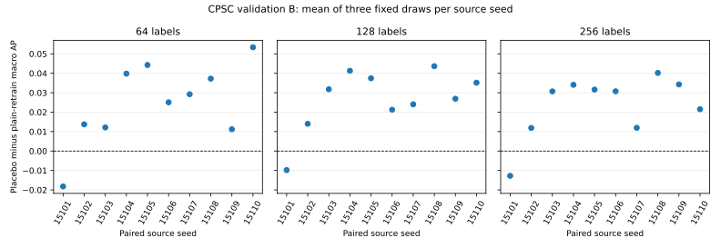
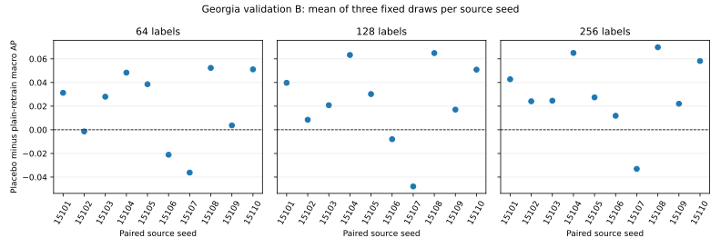

# Phase5 — multi-seed and Georgia development replication

Completed fixed validation analyses only. No CPSC test data or Phase4C test outputs were loaded. No Georgia test signal/label or PTB-XL fold10 was loaded. No commit, push, merge, tuning or test evaluation occurred.

## Part A — source training

Ten paired source seeds per arm. Seeds15101–15103 reuse the existing hash-verified Phase4C sources;15104–15110 are new fixed50-epoch source fits. Both arms use PTB-XL training folds1–8 and checkpoint selection on fold9 AP/BCE. Fold9 AUROC below is descriptive, not the checkpoint-selection criterion. Neither arm used target inputs during pretraining. Source checkpoint SHA-256/state/history identities remain in the gitignored source manifest.

| Source seed | Plain retrain fold9 macro AUROC | Placebo fold9 macro AUROC | Plain selected epoch | Placebo selected epoch | Origin |
|---:|---:|---:|---:|---:|---|
| 15101 | 0.897550 | 0.903393 | 24 | 16 | Existing |
| 15102 | 0.903963 | 0.903111 | 22 | 15 | Existing |
| 15103 | 0.901571 | 0.903953 | 21 | 13 | Existing |
| 15104 | 0.899365 | 0.906738 | 28 | 22 | New |
| 15105 | 0.906538 | 0.908720 | 23 | 21 | New |
| 15106 | 0.906135 | 0.907272 | 25 | 23 | New |
| 15107 | 0.907270 | 0.894285 | 15 | 25 | New |
| 15108 | 0.899710 | 0.910200 | 22 | 16 | New |
| 15109 | 0.904906 | 0.906960 | 19 | 21 | New |
| 15110 | 0.899629 | 0.910014 | 29 | 20 | New |

Mean fold9 macro AUROC: plain **0.902664**; placebo **0.905465**.

## Part B — CPSC validation

All10 paired source seeds ×3 fixed label draws ×3 budgets per arm:180 fitted-vector slots per hospital. CPSC reuses54 authenticated historical validation fits and adds126 fits; Georgia has180 new fits. Target fits use the unchanged200-update full-FT recipe and save no checkpoints. A/B are disjoint500-record validation roles; all draws are disjoint from both. Every model is evaluated on the same B records, not independent cohorts.

| Budget | Arm | A macro AP | A macro AUROC | B macro AP | B macro AUROC | B CD AP | B STTC AP |
|---:|---|---:|---:|---:|---:|---:|---:|
| 64 | plain | 0.600114 | 0.824015 | 0.608663 | 0.813441 | 0.745156 | 0.472171 |
| 64 | placebo | 0.609306 | 0.827081 | 0.633457 | 0.825340 | 0.753025 | 0.513889 |
| 128 | plain | 0.640163 | 0.843183 | 0.642210 | 0.831338 | 0.781474 | 0.502945 |
| 128 | placebo | 0.649955 | 0.847229 | 0.668784 | 0.841663 | 0.795221 | 0.542348 |
| 256 | plain | 0.668389 | 0.851900 | 0.663501 | 0.841198 | 0.813302 | 0.513699 |
| 256 | placebo | 0.674777 | 0.855830 | 0.686919 | 0.848589 | 0.823458 | 0.550380 |

| Budget | Placebo − plain macro AP | Paired hierarchical95% CI | Valid replicates | Macro AUROC difference [95% CI] |
|---:|---:|---|---:|---|
| 64 | +0.024793 | [+0.005832, +0.043429] | 10000 | +0.011899 [+0.001723, +0.022199] |
| 128 | +0.026575 | [+0.009361, +0.042475] | 10000 | +0.010325 [+0.000922, +0.019920] |
| 256 | +0.023419 | [+0.006481, +0.039447] | 10000 | +0.007391 [-0.000985, +0.015891] |

Points show per-seed differences averaged over three paired draws, not per-seed confidence intervals. Hierarchical intervals first resample paired source seeds, then one shared B-record/known-group resample across both arms, all selected seeds, draws and labels.10000 replicates, seed20261201, percentile95%, minimum9500 supported; no redraw or undefined-value imputation. Source-training randomness is included; uncertainty remains conditional on the available training cohort, fixed label draws, source-selection rule and known record linkage. These reused validation results are descriptive development evidence, not confirmatory hospital-test findings.

## Part C — Georgia validation

All10 paired source seeds ×3 fixed label draws ×3 budgets per arm:180 fitted-vector slots per hospital. CPSC reuses54 authenticated historical validation fits and adds126 fits; Georgia has180 new fits. Target fits use the unchanged200-update full-FT recipe and save no checkpoints. A/B are disjoint500-record validation roles; all draws are disjoint from both. Every model is evaluated on the same B records, not independent cohorts.

| Budget | Arm | A macro AP | A macro AUROC | B macro AP | B macro AUROC | B CD AP | B STTC AP |
|---:|---|---:|---:|---:|---:|---:|---:|
| 64 | plain | 0.666481 | 0.836739 | 0.656788 | 0.825575 | 0.622558 | 0.691017 |
| 64 | placebo | 0.671759 | 0.840343 | 0.676256 | 0.833764 | 0.636610 | 0.715903 |
| 128 | plain | 0.680040 | 0.845146 | 0.665868 | 0.833451 | 0.635183 | 0.696554 |
| 128 | placebo | 0.681805 | 0.848883 | 0.689815 | 0.844669 | 0.648745 | 0.730884 |
| 256 | plain | 0.712276 | 0.859479 | 0.693381 | 0.847646 | 0.656912 | 0.729850 |
| 256 | placebo | 0.720731 | 0.862796 | 0.724653 | 0.859560 | 0.689248 | 0.760058 |

| Budget | Placebo − plain macro AP | Paired hierarchical95% CI | Valid replicates | Macro AUROC difference [95% CI] |
|---:|---:|---|---:|---|
| 64 | +0.019469 | [-0.004297, +0.042703] | 10000 | +0.008189 [-0.003878, +0.020706] |
| 128 | +0.023946 | [-0.001419, +0.048311] | 10000 | +0.011219 [-0.001256, +0.024220] |
| 256 | +0.031272 | [+0.007667, +0.054146] | 10000 | +0.011914 [+0.001387, +0.023178] |

Points show per-seed differences averaged over three paired draws, not per-seed confidence intervals. Hierarchical intervals first resample paired source seeds, then one shared B-record/known-group resample across both arms, all selected seeds, draws and labels.10000 replicates, seed20261201, percentile95%, minimum9500 supported; no redraw or undefined-value imputation. Source-training randomness is included; uncertainty remains conditional on the available training cohort, fixed label draws, source-selection rule and known record linkage. These reused validation results are descriptive development evidence, not confirmatory hospital-test findings.

## Georgia label-blind preparation

| Role | Records | CD positive proxy | STTC positive proxy | CD prevalence | STTC prevalence |
|---|---:|---:|---:|---:|---:|
| pool | 6120 | 1151 | 2720 | 0.188072 | 0.444444 |
| A | 500 | 94 | 223 | 0.188000 | 0.446000 |
| B | 500 | 94 | 223 | 0.188000 | 0.446000 |
| Locked test | 4081 | Not accessed | Not accessed | Not accessed | Not accessed |

All2040 original20% survey records are in the pool. Remaining canonical IDs were split label-blind, seed79101; no future test label or signal was opened. Known native duplicates had already been canonicalized under the Experiment3 audit; groups stay together. Pool labels alone stratified A/B, seed79102. The nested label-blind draws contain731 distinct records across budgets/draws. A/B, validation/draw, pool/test, survey/test and known-group overlaps are all zero.

Membership lists, their SHA-256 values, raw-input fingerprints and adaptation-only bundle manifest are private. Test IDs live only in the separate ID-only assignment; the model-facing bundle stores only one-way exclusion hashes. The test prevalence will be reported only after a later authorized scoring operation.

## Interpretation and preservation

Georgia is a dataset/domain and not proof of a single homogeneous hospital/device population. Endpoints are recorded-code CD/STTC annotation-union proxies, not adjudicated diagnoses; omitted target annotations are not clinical proof of absence. Patient linkage and PTB-target waveform overlap remain unverified under the original audit's limitations. More source seeds do not remove those limitations. The old Phase3 survey had already been used for domain feasibility; it is excluded from the future test. Historical all-domain code/duplicate audits and original stratification had seen header labels; the present ID-only split does not erase that history.

The Georgia confirmatory protocol is written after these development results and must be committed by the author before explicit continuation. No Georgia test evaluation is performed here. All earlier source checkpoints/results/protocols and consumed operations are preserved unchanged. Public source code, aggregates and figures are uncommitted; private arrays/checkpoints/memberships remain gitignored.
